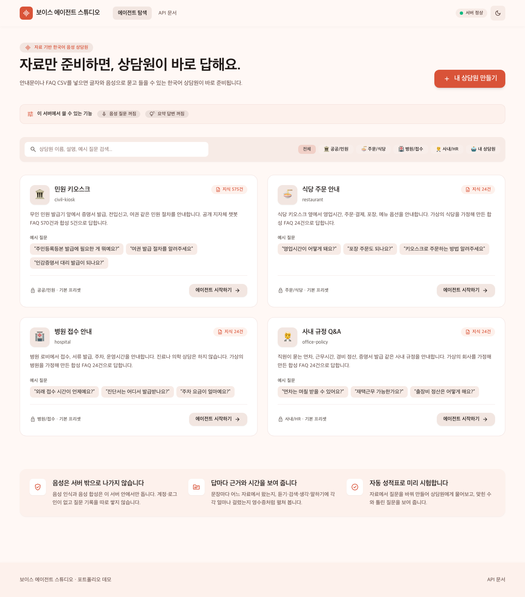
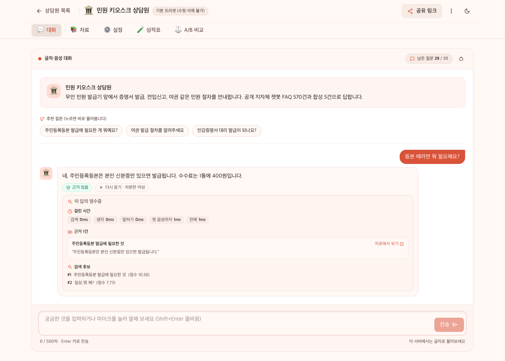
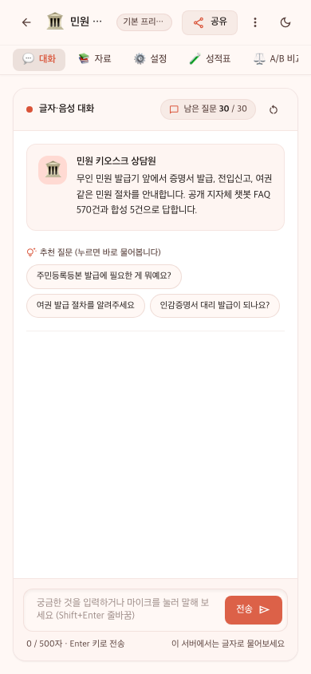
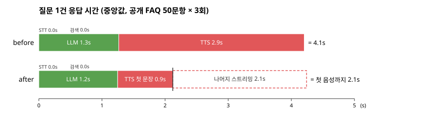

# voice-agent

투명한 음성 에이전트 빌더. 텍스트나 FAQ CSV를 넣으면 상담원이 생기고, 매 턴 단계별 지연·문장별 근거·검색 후보와 자동 성적표를 API로 돌려준다 (계약 [docs/api.md](docs/api.md)).

A transparent voice agent builder: paste your FAQ, talk to your agent, and see per-turn latency and the source behind every sentence. Speech in, RAG-grounded answer, speech out, with latency measured per stage. (Phase 1, below, is the self-service civic kiosk preset.)

Status: real STT (faster-whisper small) + real TTS (Supertonic 3) + BM25 retrieval over a public civil-service FAQ (575 entries) + LLM summary by Qwen `qwen3.7-flash` (API, optional; `LLM_BACKEND=qwen`, default is a template stub). Rebuilt on public data.

개인정보: `LLM_BACKEND=qwen` 일 때 질문 문장과 공개 FAQ 답변만 외부 API로 나가며 음성은 외부로 보내지 않는다(STT·TTS 는 기기 안에서 돈다).

## 에이전트 빌더

한 서버 프로세스가 프리셋 4종과 사용자 상담원(최대 200개)을 메모리에 두고, 음성 인식·합성 모델은 하나씩만 올려 함께 쓴다. 상담원마다 자기 문서·말투·목소리·답 길이·모를 때 동작·피할 주제를 가진다. 매 턴 SSE 로 문장마다 음성(WAV)과 근거(어느 조각의 어느 문장인지, 겹침 비율)가 오고, 끝에 단계별 시간(듣기·검색·생각·말하기, 첫 음성까지)과 검색 후보(최대 3개, 제목·점수)가 온다. 근거를 못 찾은 문장은 `supported: false` 로 표시한다. 성적표는 상담원 문서에서 질문을 규칙으로 만들어 글자·음성으로 묻고 적중 수·틀린 질문·힌트를 돌려주는 비동기 작업이고, A/B 비교는 같은 질문을 설정 두 개로 답해 나란히 돌려준다.

- API 계약: [docs/api.md](docs/api.md) (엔드포인트·SSE 이벤트·오류 code·상한·시나리오별 호출 순서). 결정 기록은 `docs/decisions.md` ADR-009 (화면은 ADR-011).

### 직접 써보기

1. 서버를 띄운다. 둘 중 하나.
   ```sh
   uv sync --extra dev && uv run uvicorn app.main:app --host localhost --port 8765    # 스텁: 무음, 모델 다운로드 없음
   uv sync --extra dev --extra tts --extra stt && STT_BACKEND=whisper TTS_BACKEND=supertonic RETRIEVER_BACKEND=bm25 FAQ_PATH=data/faq/faq.jsonl uv run --no-sync uvicorn app.main:app --host localhost --port 8765    # 실제 음성(듣기·말하기)
   ```
   스텁 서버는 듣기·말하기가 꺼져 있어 글자로만 묻고 답한다. 🎤 와 음성 답은 두 번째 명령(실제 음성)으로 띄웠을 때만 나온다.
2. `http://localhost:8765/studio` 를 연다(`/` 도 여기로 넘어간다). 프리셋 카드 4장 중 하나에서 "에이전트 시작하기"를 누르거나, "내 상담원 만들기"에서 글을 붙여 넣거나 `질문,답변` 두 열 CSV 를 올리고 "상담원 만들기"를 누른다. 만든 상담원은 이 브라우저의 "내 상담원" 칩에 남는다. 상담원은 서버 메모리에만 있어 서버를 다시 띄우면 사라진다(그때 스튜디오가 남은 칩을 확인하며 로그에 `GET /api/agents/<id> 404` 가 찍히고 칩을 지운다. 정상 동작이다).
   - 바로 써 볼 자료: `data/samples/fitness-center.txt`(글 탭에 붙여 넣기, 13개 절) · `data/samples/fitness-center.csv`(CSV 탭, 18행). 가상의 헬스장 안내이고 두 파일 내용은 같다. 물어볼 질문 예: "일요일에도 문 열어요?", "PT 당일 취소하면 어떻게 돼요?", "수영장 있어요?"(자료에 없음 → "자료에 없다"), "주차 되나요?". 기대 답은 `tests/e2e/test_fitness_samples.py`, 검색 규칙은 `docs/decisions.md` ADR-012.
3. 워크스페이스(`/studio/app?agent=<id>`)의 "대화" 탭에서 🎤 를 누르고 말한 뒤 다시 누르거나(실제 음성 서버), 글자로 묻거나 예시 질문을 누른다. 답 아래 "이 답의 영수증"을 펼치면 단계별 시간 막대·근거 각주·찾아본 자료가 보인다. "자료" 탭은 상담원이 아는 자료 조각, "설정" 탭은 설정 바꾸기(내 상담원만), "성적표"·"A/B 비교" 탭은 시험해보기와 비교다. "공유" 로 복사한 링크를 연 사람은 같은 상담원 워크스페이스로 바로 들어온다. 예전 공유 링크(`/talk?…`)는 같은 쿼리로 `/studio/app` 에 넘어간다.







1차 키오스크 데모 화면은 `http://localhost:8765/static/archive/kiosk/index.html` 에 보관돼 있다. 옛 두 페이지 화면과 함께 `app/static/archive/README.md` 에 정리했다.

### 실행

```sh
uv sync --extra dev && uv run uvicorn app.main:app --host localhost --port 8765    # 스텁(무음, 모델 다운로드 없음)
curl -s localhost:8765/api/presets
SID=$(curl -s -X POST localhost:8765/api/agents/preset-civil-kiosk/sessions | python3 -c 'import json,sys; print(json.load(sys.stdin)["session_id"])')
curl -N -X POST localhost:8765/api/agents/preset-civil-kiosk/turns/stream -H 'Content-Type: application/json' -d "{\"session_id\":\"$SID\",\"text\":\"등본 떼려면 뭐 필요해요?\"}"
```

실제 음성(듣기·말하기)은 1차와 같은 명령으로 띄운다: `uv sync --extra dev --extra tts --extra stt` 후 `STT_BACKEND=whisper TTS_BACKEND=supertonic uv run --extra tts --extra stt uvicorn app.main:app --host localhost --port 8765`. 상담원 만들기·설정 변경·음성 질문·성적표·A/B 호출은 `docs/api.md` 7절.

### 프리셋 4종

| preset_id | 제목 | 지식 조각 | 출처 |
|---|---|---|---|
| civil-kiosk | 민원 키오스크 | 575 | 공개 지자체 챗봇 FAQ 570 + 합성 5 (1차와 같은 `data/faq/faq.jsonl`) |
| restaurant | 식당 주문 안내 | 24 | 가상 식당 합성 FAQ (CC0) |
| hospital | 병원 접수 안내 | 24 | 가상 병원 합성 FAQ (CC0, 진료·의학 상담 안 함) |
| office-policy | 사내 규정 Q&A | 24 | 가상 회사 합성 FAQ (CC0) |

데이터 출처·작성 방식은 `data/README.md`.

### 성적표 (프리셋, 질문 30개)

| 프리셋 | 모드 | 글자 적중 | 음성 적중 | 첫 음성 p50 / p95 (ms) | 시간 기준 | 같은 명령 2회차 비교 |
|---|---|---|---|---|---|---|
| civil-kiosk | stub | 30/30 | - | 0.4 / 0.6 | 글자 | REPRO OK |
| restaurant | stub | 30/30 | - | 0.1 / 0.1 | 글자 | REPRO OK |
| hospital | stub | 30/30 | - | 0.1 / 0.2 | 글자 | REPRO OK |
| office-policy | stub | 29/30 | - | 0.1 / 0.1 | 글자 | REPRO OK |
| civil-kiosk | full | 30/30 | 28/30 | 3866.3 / 7047.0 | 음성 | REPRO OK (2회차 3823.7 / 7694.5 ms) |
| restaurant | full | 30/30 | 28/30 | 3959.9 / 4321.9 | 음성 | 1회만 실행 (비교 안 함) |

- 적중 = 첫 번째 검색 후보가 그 질문을 만든 조각이고 답 종류가 `grounded`. 질문 30개 = 조각 15개 × (원문 그대로 1 + 사람 말투 1).
- 모드: stub = 기본 설정(음성 인식·합성 스텁, 음성 채널 없음 `voice_unavailable_reason: "stub_audio"`, 시간은 글자 질문 기준). full = STT faster-whisper small(`STT_BACKEND=whisper`)·TTS Supertonic 3(`TTS_BACKEND=supertonic`), LLM 은 템플릿 스텁(요약 없음), Apple Silicon CPU. full 의 첫 음성 시간은 음성 질문 턴 기준이라 듣기(STT)가 포함된다.
- 틀린 것: office-policy stub 1건은 사람 말투 글자 질문이 다른 조각을 찾음(`wrong_chunk`). full 의 음성 오답 2건씩은 모두 글자로는 맞혔는데 음성으로 틀림(`misheard`). civil-kiosk full 은 1·2회차 틀린 질문 id 가 같다.
- 2회차 비교(`--check-against`)는 글자·음성 적중 수와 틀린 질문 id 만 비교하고 시간은 비교하지 않는다. 그래서 civil-kiosk full 은 시간이 달라도 REPRO OK 다.
- 숫자는 아래 명령이 쓴 JSON 의 `text`·`voice`·`first_audio_ms` 값 그대로다(서버가 ms 를 소수 1자리로 반올림, 추가 반올림 없음). JSON·로그는 `.ai/tasks/T-20261023-agent-builder/logs/` 의 `sc-*.json`, `s12-stub.log`, `s12-full.log`.

CAVEAT: 성적표 질문은 문서에서 규칙으로 만든 것(제목 그대로, 어미·어순 바꾸기)이라 실제 사용자 질문보다 쉽다. 1차의 같은 종류 규칙 세트는 top1 1.000, AI 가 쓴 구어체 세트는 0.289 였다(아래 "Measured retrieval", ADR-008). 음성 질문도 사람 목소리가 아니라 Supertonic 으로 합성한 음성(`calm_male`)이다. 그래서 이 점수는 "문서에 있는 표현으로 물으면 찾는가"를 볼 뿐 실사용 정확도가 아니다. 보고서에도 같은 주의 문구(`caveat`)가 늘 붙는다.

재현 (stub, 4종 합계 약 1초):

```sh
uv sync --extra dev
OUT=.ai/tasks/T-20261023-agent-builder/logs
for p in civil-kiosk restaurant hospital office-policy; do
  uv run --no-sync python scripts/scorecard.py --preset $p --n 30 --out $OUT/sc-$p-stub-1.json
  uv run --no-sync python scripts/scorecard.py --preset $p --n 30 --out $OUT/sc-$p-stub-2.json --check-against $OUT/sc-$p-stub-1.json   # REPRO OK|DIFF
done
```

재현 (full, 이번 실행 civil-kiosk 1회 약 5분 반·restaurant 약 4분, 로그의 시작·끝 시각 기준):

```sh
uv sync --extra dev --extra tts --extra stt
OUT=.ai/tasks/T-20261023-agent-builder/logs
STT_BACKEND=whisper TTS_BACKEND=supertonic uv run --no-sync python scripts/scorecard.py --preset civil-kiosk --n 30 --out $OUT/sc-civil-kiosk-full-1.json
STT_BACKEND=whisper TTS_BACKEND=supertonic uv run --no-sync python scripts/scorecard.py --preset civil-kiosk --n 30 --out $OUT/sc-civil-kiosk-full-2.json --check-against $OUT/sc-civil-kiosk-full-1.json
STT_BACKEND=whisper TTS_BACKEND=supertonic uv run --no-sync python scripts/scorecard.py --preset restaurant --n 30 --out $OUT/sc-restaurant-full-1.json
```

`scripts/scorecard.py` 는 서버 없이 프로세스 안에서 돈다. 각 실행은 `SCORECARD preset=… text=… voice=… p50_ms=… p95_ms=…` 한 줄을 찍고 `<out>` JSON 과 `<out>.md` 표를 쓴다.

### 지키는 것

- 음성은 서버 밖으로 나가지 않는다. 음성 인식·합성은 서버 프로세스 안에서 돈다.
- 요약을 켠 상담원에서만, 서버에 LLM 키가 있을 때만 질문 문장과 근거 조각 몇 개가 외부 LLM API 로 간다. 기본은 꺼짐이다.
- 올린 문서는 그 상담원에만 쓰이고 메모리에만 있다(디스크·DB 저장 없음). 상담원·세션은 기본 24시간(`AGENT_TTL_HOURS`) 뒤 지워지고, 서버를 재시작하면 프리셋을 뺀 전부가 사라진다. 계정·쿠키가 없고 질문 기록을 따로 쌓지 않는다.
- 상한 (기본값, 환경변수로 바꿈): 사용자 상담원 200개(`MAX_AGENTS`), 텍스트 20,000자(`MAX_TEXT_CHARS`), CSV 300행(`MAX_CSV_ROWS`)·100,000자(`MAX_CSV_CHARS`), 세션당 질문 30개(`SESSION_MAX_QUESTIONS`), 동시 턴 2(`TURN_CONCURRENCY`)·대기열 8(`TURN_QUEUE_MAX`), 성적표 실행 1개 + 대기 4(`SCORECARD_QUEUE_MAX`). 질문 500자, 녹음 10 MiB 는 고정. 넘으면 413·429·503 과 오류 code 로 알린다(`docs/api.md` 2·4절).
- 프리셋 상담원은 읽기 전용이라 고치거나 지울 수 없다(403 `preset_read_only`).

## Latency (before / after)



Qwen 요약 구성 (현재, `LLM_BACKEND=qwen`, before·after 모두 Qwen):

| 지표 | before (/api/ask) | after (/api/ask-stream) | 비고 |
|---|---|---|---|
| 첫 음성까지 (p50 / p95) | 4135.6 / 6399.3 ms | 2121.2 / 3100.2 ms | 서버 측. before 는 응답 완료 = total_ms |
| 전체 응답 (p50 / p95) | 4135.6 / 6399.3 ms | 4241.5 / 5984.0 ms | total_ms (after 는 마지막 문장 WAV 까지) |
| STT (p50) | 0.0 ms | 0.0 ms | 글자 입력, STT 미포함 |
| 검색 (p50) | 0.0 ms | 0.0 ms | BM25 |
| LLM (p50) | 1266.0 ms | 1248.2 ms | Qwen qwen3.7-flash (API) |
| TTS (p50) | 2938.8 ms | 3291.1 ms | after 는 문장별 합 |
| TTS RTF (동시 1) | 0.19 | 0.20 | tts_ms / 음성 길이 |
| 동시 4 요청 | 미측정 | 아래 추가 표 (summary-extra.md) | 구성은 표 아래 설명 |
| 검색 적중 (top1 = 질문 id) | 150/150 | 150/150 | |
| 요청 수 (오류) | 150 (0) | 150 (0) | 50 질문 × 3 회 |

클라이언트 측 첫 음성 p50: before 4140.8 ms / after 2124.1 ms

실행 구성: 글자 입력(STT 미사용), 검색 BM25(`RETRIEVER_BACKEND=bm25`, 공개 FAQ 575건), LLM Qwen `qwen3.7-flash`(`LLM_BACKEND=qwen`, 키는 `.env` 의 `LLM_API_KEY`, 근거 FAQ 1건을 1~3문장으로 요약, 스트리밍), TTS Supertonic 3(`TTS_BACKEND=supertonic`), Apple Silicon CPU, 동시 1요청. after 는 LLM 이 첫 조각을 내는 즉시 그 조각의 TTS 를 시작한다(ADR-007). `/health` 의 `pipeline_mode` 가 `"stub"` 로 기록되지만, 이는 `app/config.py` 의 기본값이자 `build_pipeline` 이 받는 유일한 값(`app/pipeline/runner.py`)일 뿐이고 실제 STT·검색·LLM·TTS 백엔드는 위 `*_BACKEND` 환경변수로 따로 고른다.

LLM 스텁 구성 (이전 측정, 참고): LLM 을 템플릿 스텁(원문 답변 그대로, LLM 0.0 ms)으로 둔 같은 bench 에서 첫 음성 p50 / p95 는 before 4986.1 / 8220.0 ms, after 871.1 / 2214.4 ms 였다. 원본 표는 `git show 11136b7:bench/results/summary.md`. 스텁은 원문 전체를 읽어 TTS 가 길고(after TTS p50 5394.1 ms), Qwen 구성은 답을 1~3문장으로 줄여 TTS 가 짧은 대신(3291.1 ms) 첫 음성 앞에 LLM 첫 조각 대기가 붙는다. 두 구성은 답변 길이가 달라 첫 음성·전체 시간을 직접 비교하지 않는다.

### 동시 요청·음성 입력 (추가 측정)

| 지표 | 글자 동시 1 | 글자 동시 4 | 음성 입력 동시 1 | 비고 |
|---|---|---|---|---|
| 첫 음성까지 (p50 / p95) | 898.2 / 2200.1 ms | 1523.4 / 3863.6 ms | 3704.0 / 5119.9 ms | 서버 측 first_audio_ms |
| 전체 응답 (p50 / p95) | 5687.5 / 11915.8 ms | 9171.4 / 18844.6 ms | 8075.9 / 13632.0 ms | total_ms |
| 클라이언트 첫 음성 (p50 / p95) | 901.0 / 2203.8 ms | 1533.6 / 3874.6 ms | 3707.8 / 5126.2 ms | 요청 전송 ~ 첫 audio 이벤트, 동시 4 는 경합 포함 |
| STT (p50) | 0.0 ms | 0.0 ms | 2738.7 ms | 음성 입력만 실제 STT |
| LLM (p50) | 0.0 ms | 0.0 ms | 0.0 ms | |
| TTS (p50) | 5677.7 ms | 9152.0 ms | 5260.6 ms | 문장별 합 |
| 검색 적중 (top1 = 질문 id) | 150/150 | 150/150 | 135/150 | 음성은 STT 오인식 포함 |
| 요청 수 (오류) | 150 (0) | 150 (0) | 150 (0) | 50 질문 × 3 회 |

구성: LLM 템플릿 스텁(`LLM_BACKEND=stub`, 원문 답변 그대로), STT faster-whisper small(`STT_BACKEND=whisper`), TTS Supertonic 3(`TTS_BACKEND=supertonic`), 검색 BM25(`RETRIEVER_BACKEND=bm25`), Apple Silicon CPU, 엔드포인트 `/api/ask-stream`(글자)·`/api/ask-audio-stream`(음성). 질문 음성은 `bench/make_audio.py` 가 Supertonic 으로 합성한 WAV 라 실제 사람 발화보다 깨끗하다. 이 표는 LLM 스텁 구성이고 위 본 표는 Qwen 구성이라 LLM·답변 길이가 달라 두 표의 수치를 직접 비교하지 않는다.

검색·STT 의 `0.0 ms` 는 기록 단위가 0.1 ms(소수 1자리 반올림)라서 나온 값이다. BM25 검색은 300개 레코드 중 대부분이 0.0 또는 0.1 ms(p50 < 0.1 ms), 최댓값 3.4 ms(`bench/results/*.jsonl` 의 `stages.retrieve_ms`).

원본 환경 (참고, 비교 불가): 10.52 s → 7.40 s. 다른 하드웨어·다른 모델·실사용 질문이라 위 표와 비교할 수 없다. 출처 docs/vision.md.

무엇을 바꿨나: 답변 전체를 한 번에 합성하던 `/api/ask` 대신, 문장 단위로 합성해 첫 문장 WAV 부터 보내는 `/api/ask-stream`(SSE, ADR-005). LLM 은 Qwen 스트리밍 출력의 첫 조각(문장 끝, 또는 15자 이상에서 쉼표·연결어미 뒤)부터 TTS 와 겹친다(ADR-007). 측정 설계는 `docs/decisions.md` ADR-006.

```sh
uv sync --extra dev --extra tts --extra stt
LLM_BACKEND=qwen STT_BACKEND=whisper TTS_BACKEND=supertonic RETRIEVER_BACKEND=bm25 FAQ_PATH=data/faq/faq.jsonl uv run --extra tts --extra stt uvicorn app.main:app --host localhost --port 8765 &   # .env 에 LLM_API_KEY
./bench/run.sh --config before     # 질문 50개 × 3회, 약 15분
./bench/run.sh --config after
./bench/summarize.sh               # bench/results/summary.md + waterfall.svg
```

추가 표 재현 (LLM 스텁 서버, API 호출 없음, 합계 약 45분 — 이번 측정 c1 15분·c4 7분·audio 22분, jsonl 헤더 `started_at` 과 파일 기록 시각 기준):

```sh
STT_BACKEND=whisper TTS_BACKEND=supertonic RETRIEVER_BACKEND=bm25 FAQ_PATH=data/faq/faq.jsonl LLM_BACKEND=stub uv run --extra tts --extra stt uvicorn app.main:app --host localhost --port 8765 &
uv run --extra tts --extra stt python bench/make_audio.py           # 질문 WAV 50개 → bench/audio/ (git 무시)
./bench/run.sh --config after --runs 3 --out bench/results/after-c1.jsonl
./bench/run.sh --config after --concurrency 4 --runs 3 --out bench/results/after-c4.jsonl
./bench/run.sh --config audio --runs 3 --out bench/results/audio.jsonl
./bench/summarize.sh --c1 bench/results/after-c1.jsonl --c4 bench/results/after-c4.jsonl --audio bench/results/audio.jsonl   # + summary-extra.md
```

`--out` 없이 돌리면 Qwen 구성의 `bench/results/after.jsonl` 을 덮어쓴다.

## Run

Default (stub STT/TTS, silent audio, no model download):

```sh
uv sync --extra dev && uv run uvicorn app.main:app --host localhost --port 8765
```

Streaming answer (one SSE `audio` event per sentence, each a complete WAV; events `meta` → `audio`×N → `done`, with `first_audio_ms` in `done.timings`):

```sh
curl -N -X POST localhost:8765/api/ask-stream -H 'Content-Type: application/json' -d '{"text":"주민등록등본 발급"}'
```

Real Korean speech in and out (CPU only, no torch):

```sh
uv sync --extra dev --extra tts --extra stt
STT_BACKEND=whisper TTS_BACKEND=supertonic uv run --extra tts --extra stt uvicorn app.main:app --host localhost --port 8765
```

Open http://localhost:8765/static/archive/kiosk/index.html (the phase-1 kiosk demo; `/` now redirects to the agent studio `/studio`, see "직접 써보기"). Press 🎤, speak, press 🎤 again to send (recording stops on its own after 15 s; the browser asks for microphone permission once). Typing a question and pressing the button still works. The answer audio tries to autoplay; if the browser blocks it, use the play button. Asking a new question while an answer is playing stops the previous audio, and late audio from the earlier request is ignored.

- STT: `Systran/faster-whisper-small`, CPU int8. First run downloads about 484 MB (model.bin) into `~/.cache/huggingface/hub/` (stored in the shared `blobs/` folder). License: code MIT, weights MIT.
- TTS: `TTS_VOICE` selects the speaker, `F1`~`F5` or `M1`~`M5` (default `F1`). First run downloads about 385~415 MB of ONNX weights into `~/.cache/supertonic3/` (override with `SUPERTONIC_CACHE_DIR`).
- TTS license: model weights OpenRAIL-M (use restrictions apply, commercial use allowed); code MIT. The original developer's GitHub repository was archived in 2026; the weights are mirrored at `supertone-oss-archive/supertonic-3`.

Settings are listed in `.env.example`.

LLM summary with Qwen (optional, needs an API key):

```sh
# .env:  LLM_API_KEY=<your DashScope international key>
LLM_BACKEND=qwen STT_BACKEND=whisper TTS_BACKEND=supertonic RETRIEVER_BACKEND=bm25 FAQ_PATH=data/faq/faq.jsonl uv run --extra tts --extra stt uvicorn app.main:app --host localhost --port 8765
```

- Model `qwen3.7-flash` (`LLM_MODEL`), OpenAI-compatible endpoint `LLM_BASE_URL` (default: DashScope international, Singapore), timeout `LLM_TIMEOUT_S` (default 8 s). Standard library `urllib` only, no new dependency.
- Price (official Model Studio pricing page, updated 2026-10-22): Singapore, 0–32K input tokens, input USD 0.03 / output USD 0.13 per 1M tokens.
- If `LLM_API_KEY` is empty the template stub is used. If the API call fails, times out or returns too little text, the original FAQ answer is spoken instead.
- Privacy: only the question text and the retrieved public FAQ answer are sent to the API; audio never leaves the machine.
- Real-API tests (not in the default commands): `uv run pytest tests/live -q` with the server above running.

FAQ retrieval over public data (BM25, character bigrams, no extra dependency):

```sh
./scripts/prepare_data.sh   # needs `uv sync --extra dev` (openpyxl) first
STT_BACKEND=whisper TTS_BACKEND=supertonic RETRIEVER_BACKEND=bm25 FAQ_PATH=data/faq/faq.jsonl uv run --extra tts --extra stt uvicorn app.main:app --host localhost --port 8765
# search only, no speech models:
RETRIEVER_BACKEND=bm25 FAQ_PATH=data/faq/faq.jsonl uv run uvicorn app.main:app --host localhost --port 8765
```

- `prepare_data.sh` downloads the raw XLSX into `data/raw/` (git-ignored), writes `data/faq/faq.jsonl` and `tests/fixtures/faq_eval.jsonl`, then runs the evaluation. The committed `faq.jsonl` is already the result, so the server runs without this step.
- `RETRIEVER_BACKEND` defaults to `keyword` (the 5 synthetic FAQs in `data/faq/sample_faq.json`). The answer shows `출처: faq-NNN`.
- Data: 경기도 시흥시 챗봇 FAQ 시나리오 (공공데이터포털 15148282, 2025-09-01), license "이용허락범위 제한 없음". 570 public rows (of 704 distinct topics, after near-duplicate, short-row and chatbot-scenario-row removal) + 5 synthetic = 575. The indexed "question" is the dataset's intent name (a short topic such as "어린이 예방접종"), not a full question sentence. Details in `data/README.md`, decision in `docs/decisions.md` ADR-004.

## Test

```sh
uv run pytest tests/unit -q                               # unit, no model needed
uv run pytest tests/data -q                               # retrieval accuracy on data/faq/faq.jsonl
uv run --extra tts --extra stt pytest tests/model -q      # real models, needs the downloads above
```

E2E tests run against a server on `localhost:8765`:

```sh
# server started with the full bm25 command above (whisper + supertonic + bm25): full suite
uv run pytest tests/e2e -q
# server in default stub mode (no model): skip the real-model checks
uv run pytest tests/e2e -q --ignore=tests/e2e/test_tts_real.py --ignore=tests/e2e/test_stt_real.py --ignore=tests/e2e/test_faq_bm25.py --ignore=tests/e2e/test_stream_real.py --ignore=tests/e2e/test_bench_audio_real.py --ignore=tests/e2e/test_colloquial_ask.py --ignore=tests/e2e/test_agent_builder_real.py --ignore=tests/e2e/test_studio_voice_real.py
```

The test question audio `tests/fixtures/ask_faq001_ko.wav` is synthesized speech (not a human recording). Regenerate it with:

```sh
uv run --extra tts --extra stt python scripts/make_fixture_audio.py --out tests/fixtures/ask_faq001_ko.wav
```

## Measured latency

On this machine (Apple Silicon, CPU):

- STT (Whisper small int8): model load about 10 s; a 3.7 s spoken question is recognized in about 2.7 s `stt_ms`. Reproduce by starting the server with `STT_BACKEND=whisper` and reading `timings.stt_ms` of `POST /api/ask-audio` (body: the fixture WAV), or the "듣기" value on the demo page.
- TTS (Supertonic 3): model load about 9.9 s, one Korean sentence `tts_ms` about 1.5 s. Reproduce with `TTS_BACKEND=supertonic` and `timings.tts_ms` of `POST /api/ask`, or the "말하기" value on the demo page.
- Sentence-streaming TTS (Supertonic 3, `/api/ask-stream`): the first sentence's audio is ready long before the whole answer is synthesized. `first_audio_ms` = time from request start until the first sentence WAV is ready; full `tts_ms` = sum of per-sentence synthesis.

| answer id | chars | sentences | full tts_ms (A) | first_audio_ms (B) | B / A |
|-----------|-------|-----------|-----------------|--------------------|-------|
| faq-020 | 577 | 8 | 14342.5 | 895.8 | 0.062 |

Reproduce (in-process, real model): `uv run --extra tts --extra stt pytest tests/model/test_tts_stream.py -q -s` (prints `full_tts_ms=… first_audio_ms=… ratio=… sentences=…`). Over HTTP (server in the full bm25 real-model mode above, then `uv run pytest tests/e2e/test_stream_real.py -q`): `/api/ask` `tts_ms` 13688.5, first `audio` event received at 892.0 ms, ratio 0.065.

For the 50-question before/after table see "Latency (before / after)" above.

## Measured retrieval

On this machine (Apple Silicon, CPU), 575 FAQ entries.

### Rule-based set (42)

| top1 | top3 | retrieve p50 | retrieve p95 | index build |
|---|---|---|---|---|
| 1.000 | 1.000 | 0.011 ms | 0.029 ms | 1.2~1.5 ms |

Reproduce (prints the same line plus 3 sentinel checks and `RESULT PASS`):

```sh
uv run python scripts/eval_retrieval.py --faq data/faq/faq.jsonl --eval tests/fixtures/faq_eval.jsonl
```

What this number means: the evaluation set (`scripts/make_faq_eval.py`) rewrites indexed intent names with fixed rules (dropped endings, swapped word order, keywords only, spaces removed) plus 2 synthetic sentinels. top1 1.000 shows robustness to spelling, spacing and ending variations of known topics only. It is not the accuracy on real users' free-form speech. See the colloquial set below.

### Colloquial set (46, written by an AI assistant)

46 colloquial questions (written by an AI assistant from a blind brief that hides the indexed intent names; labels audited by a separate AI reviewer before freezing in commit `cd36a9e`): 38 with a known answer + 8 that the FAQ does not cover. No human wrote or labeled these questions.

| n_answerable | top1 | top3 | none_correct (n_none=8) | overall_top1 (n=46) | leak_mean | top1, low leak (< 0.34) | top1, high leak (≥ 0.34) |
|---|---|---|---|---|---|---|---|
| 38 | 0.289 | 0.421 | 0.375 | 0.304 | 0.210 | 0.219 (n=32) | 0.667 (n=6) |

Reproduce (first line is the summary above, then one `miss` line per wrong row, last line `RESULT MEASURED`; no accuracy threshold):

```sh
uv run python scripts/eval_colloquial.py --faq data/faq/faq.jsonl --eval tests/fixtures/faq_eval_colloquial.jsonl
uv run python scripts/eval_colloquial.py --faq data/faq/faq.jsonl --eval tests/fixtures/faq_eval.jsonl   # leak of the rule-based set
```

What this number means: `leak` is the share of the correct intent name's character bigrams that appear in the question. The rule-based set has leak_mean 0.815 (all 42 rows high-leak), the colloquial set 0.210, so the colloquial set gives BM25 far fewer surface clues, and top1 drops from 1.000 to 0.289 (0.219 on the 32 low-leak rows). These questions were written by an LLM following `docs/eval-colloquial.md` (writing rules, leak-reduction steps, audit checklist), so they may differ from what real citizens say at a kiosk. none_correct counts a none row as correct only when search returns nothing; with `min_score=0` most out-of-scope questions still get some hit, so it stays low. One miss (c23) returned faq-322, whose answer text is identical to the labeled faq-323; it is still counted as a miss. Improving retrieval (answer-text indexing, morphology, embeddings, a score threshold) is follow-up work (ADR-008).
