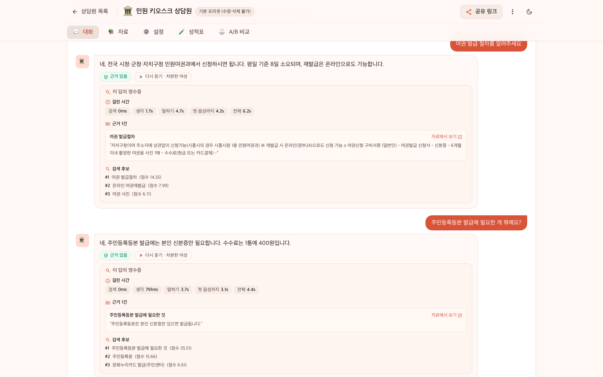
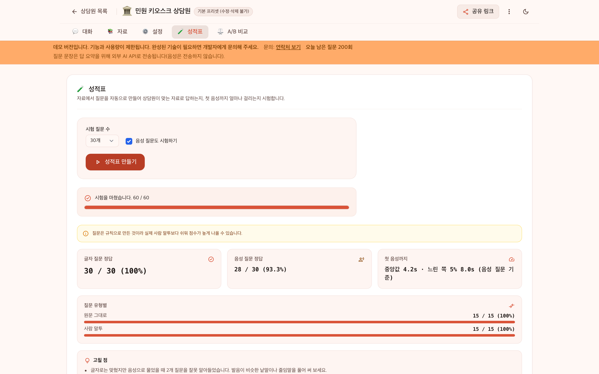
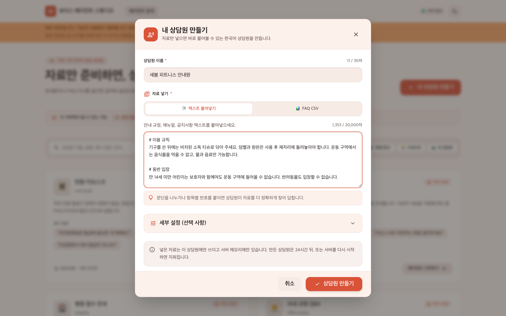
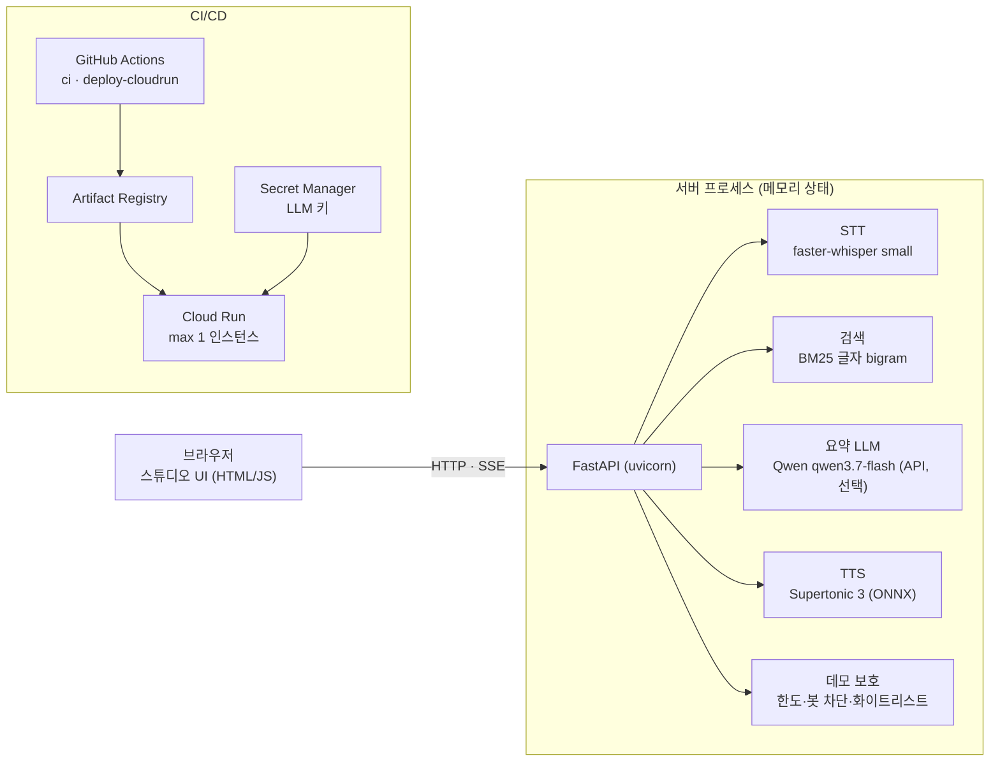

# voice-agent

[](https://github.com/ilyos-numon/voice-agent/actions/workflows/ci.yml)

**A transparent voice agent builder.** Paste text or a FAQ CSV and you get a Korean voice agent: speech in (faster-whisper), BM25 retrieval, optional LLM summary (Qwen), speech out (Supertonic 3).
Every turn shows per-stage latency, the source behind each sentence, and the retrieval candidates; an automatic scorecard and A/B compare test the agent.
Sentence-level streaming cut time-to-first-audio p50 from 4135.6 ms to 2121.2 ms (Qwen summary, 50 questions × 3, see [측정값](#측정값)).
Rebuilt on public and synthetic data only. Body below is in Korean.

**Live demo:** https://voice-agent-2z5o3mwsxq-an.a.run.app
(첫 접속이 한동안 없었다면 모델을 올리는 동안 기다려야 한다 · 방문자별 하루 사용 한도가 있다)


## 무엇을 하는가

- 글이나 `질문,답변` CSV 를 넣으면 그 자료만으로 답하는 음성 상담원이 생긴다.
- 답의 문장마다 어느 자료 조각에서 왔는지, 듣기·검색·생각·말하기에 각각 몇 ms 걸렸는지 보여 준다.
- 자료에 없는 질문은 지어내지 않고 "자료에 없다"고 답한다. 성적표와 A/B 비교로 상담원을 시험한다.

## 주요 기능

| 기능 | 내용 |
|---|---|
| 근거 표시 | 답의 문장마다 근거 조각·겹침 비율을 붙이고, 근거를 못 찾은 문장은 `supported: false` 로 표시. 검색 후보 최대 3개(제목·점수)도 함께 |
| 단계별 지연 | 매 턴 SSE 로 듣기(STT)·검색·생각(LLM)·말하기(TTS)·첫 음성까지 시간을 돌려주고 화면에 막대로 그림 |
| 문장 스트리밍 음성 | 답 전체를 합성하지 않고 첫 문장 WAV 부터 보냄. LLM 의 첫 조각이 나오는 즉시 TTS 시작 |
| 성적표 | 상담원 자료에서 질문을 규칙으로 만들어 글자·음성으로 묻고 적중 수·틀린 질문·힌트를 돌려주는 비동기 작업 |
| A/B 비교 | 같은 질문을 설정 두 개(말투·답 길이·요약 등)로 답해 나란히 비교 |
| 상담원 만들기 | 프리셋 4종 + 사용자 상담원. 말투·목소리·답 길이·모를 때 동작·피할 주제 설정, 공유 링크 |
| 음성 | 기기 안에서 도는 STT·TTS. 음성은 외부로 나가지 않음 |

| 대화와 영수증 | 성적표 |
|---|---|
|  |  |

| 내 상담원 만들기 | 휴대폰 폭 |
|---|---|
|  |  |

## 구조



- 한 서버 프로세스가 프리셋 4종과 사용자 상담원(최대 200개)을 메모리에 두고, 음성 모델은 하나씩만 올려 함께 쓴다. DB·계정·쿠키가 없다.
- 턴 흐름: (음성이면 STT) → BM25 검색 → 근거가 약하면 "모름" → (요약을 켰으면 LLM) → 문장 단위 TTS → SSE 로 문장마다 WAV·근거, 끝에 단계별 시간.
- API 계약: [docs/api.md](docs/api.md) (엔드포인트·SSE 이벤트·오류 code·상한).

## 기술 스택

| 영역 | 사용 |
|---|---|
| 서버 | Python 3.11, FastAPI, uvicorn, pydantic-settings, uv |
| STT | faster-whisper `Systran/faster-whisper-small` (CPU int8, 코드·가중치 MIT) |
| TTS | Supertonic 3 ONNX (가중치 OpenRAIL-M, 코드 MIT) |
| 검색 | BM25 직접 구현 (글자 bigram, 추가 의존성 없음) |
| LLM | Qwen `qwen3.7-flash`, OpenAI 호환 API, 표준 라이브러리 `urllib` 만 사용 (선택, 기본은 템플릿 스텁) |
| 화면 | 정적 HTML/JS + Tailwind 설정 (CDN·번들러 없음) |
| 테스트 | pytest, httpx, Playwright, ruff, mypy |
| 배포 | Docker, GitHub Actions, Workload Identity Federation, Artifact Registry, Cloud Run, Secret Manager |

## 측정값

모든 수치는 Apple Silicon CPU 개발 머신에서 아래 명령으로 잰 값이다(공개 데모 서버 수치가 아님).

### 지연: 문장 스트리밍 전후


Qwen 요약 구성 (`LLM_BACKEND=qwen`, before·after 모두 Qwen, 질문 50개 × 3회):

| 지표 | before (`/api/ask`, 전체 합성) | after (`/api/ask-stream`, 문장 스트리밍) | 비고 |
|---|---|---|---|
| 첫 음성까지 (p50 / p95) | 4135.6 / 6399.3 ms | 2121.2 / 3100.2 ms | 서버 측. before 는 응답 완료 = total_ms |
| 전체 응답 (p50 / p95) | 4135.6 / 6399.3 ms | 4241.5 / 5984.0 ms | after 는 마지막 문장 WAV 까지 |
| LLM (p50) | 1266.0 ms | 1248.2 ms | Qwen qwen3.7-flash (API) |
| TTS (p50) | 2938.8 ms | 3291.1 ms | after 는 문장별 합 |
| TTS RTF (동시 1) | 0.19 | 0.20 | tts_ms / 음성 길이 |
| 검색 적중 (top1 = 질문 id) | 150/150 | 150/150 | BM25 |
| 요청 수 (오류) | 150 (0) | 150 (0) | |

클라이언트 측 첫 음성 p50: before 4140.8 ms / after 2124.1 ms. 구성: 글자 입력(STT 미사용), BM25(공개 FAQ 575건), Supertonic 3, 동시 1요청. after 는 LLM 이 첫 조각(문장 끝, 또는 15자 이상에서 쉼표·연결어미 뒤)을 내는 즉시 TTS 를 시작한다(ADR-005·007, 측정 설계 ADR-006).

LLM 스텁 구성(원문 답변 그대로, 이전 측정)에서는 첫 음성 p50 / p95 가 before 4986.1 / 8220.0 ms → after 871.1 / 2214.4 ms 였다(원본 표 [docs/decisions.md](docs/decisions.md) ADR-006 "실측"). 스텁은 원문 전체를 읽고 Qwen 은 1~3문장으로 줄여 답 길이가 달라, 두 구성을 직접 비교하지 않는다.

```sh
uv sync --extra dev --extra tts --extra stt
LLM_BACKEND=qwen STT_BACKEND=whisper TTS_BACKEND=supertonic RETRIEVER_BACKEND=bm25 FAQ_PATH=data/faq/faq.jsonl uv run --extra tts --extra stt uvicorn app.main:app --host localhost --port 8765 &   # .env 에 LLM_API_KEY
./bench/run.sh --config before     # 질문 50개 × 3회, 약 15분
./bench/run.sh --config after
./bench/summarize.sh               # bench/results/summary.md + waterfall.svg
```

### 지연: 동시 요청·음성 입력 (LLM 스텁)

| 지표 | 글자 동시 1 | 글자 동시 4 | 음성 입력 동시 1 |
|---|---|---|---|
| 첫 음성까지 (p50 / p95) | 898.2 / 2200.1 ms | 1523.4 / 3863.6 ms | 3704.0 / 5119.9 ms |
| 전체 응답 (p50 / p95) | 5687.5 / 11915.8 ms | 9171.4 / 18844.6 ms | 8075.9 / 13632.0 ms |
| STT (p50) | - | - | 2738.7 ms |
| 검색 적중 (top1) | 150/150 | 150/150 | 135/150 (STT 오인식 포함) |
| 요청 수 (오류) | 150 (0) | 150 (0) | 150 (0) |

질문 음성은 `bench/make_audio.py` 가 Supertonic 으로 합성한 WAV 라 실제 사람 발화보다 깨끗하다. 합계 약 45분.

```sh
STT_BACKEND=whisper TTS_BACKEND=supertonic RETRIEVER_BACKEND=bm25 FAQ_PATH=data/faq/faq.jsonl LLM_BACKEND=stub uv run --extra tts --extra stt uvicorn app.main:app --host localhost --port 8765 &
uv run --extra tts --extra stt python bench/make_audio.py           # 질문 WAV 50개 → bench/audio/ (git 무시)
./bench/run.sh --config after --runs 3 --out bench/results/after-c1.jsonl
./bench/run.sh --config after --concurrency 4 --runs 3 --out bench/results/after-c4.jsonl
./bench/run.sh --config audio --runs 3 --out bench/results/audio.jsonl
./bench/summarize.sh --c1 bench/results/after-c1.jsonl --c4 bench/results/after-c4.jsonl --audio bench/results/audio.jsonl   # summary-extra.md
```

`--out` 없이 돌리면 Qwen 구성의 `bench/results/after.jsonl` 을 덮어쓴다.

긴 답 한 개(faq-020, 577자·8문장): 전체 TTS 14342.5 ms 중 첫 문장 음성은 895.8 ms 에 준비된다(비율 0.062). 재현: `uv run --extra tts --extra stt pytest tests/model/test_tts_stream.py -q -s`.

### 검색 정확도 (공개 민원 FAQ 575건, BM25)

| 세트 | top1 | top3 | 비고 |
|---|---|---|---|
| 규칙 변형 42문항 | 1.000 | 1.000 | 검색 p50 0.011 ms · p95 0.029 ms, 인덱스 생성 1.2~1.5 ms. leak_mean 0.815 |
| 구어체 46문항 (답 있음 38 + 범위 밖 8) | 0.289 | 0.421 | none_correct 0.375, overall_top1 0.304, leak_mean 0.210, low-leak(<0.34) top1 0.219 (n=32) |

```sh
uv run python scripts/eval_retrieval.py --faq data/faq/faq.jsonl --eval tests/fixtures/faq_eval.jsonl              # 규칙 세트, RESULT PASS
uv run python scripts/eval_colloquial.py --faq data/faq/faq.jsonl --eval tests/fixtures/faq_eval_colloquial.jsonl  # 구어체 세트, RESULT MEASURED
uv run python scripts/eval_colloquial.py --faq data/faq/faq.jsonl --eval tests/fixtures/faq_eval.jsonl             # 규칙 세트의 leak
```

해석: 규칙 세트는 색인된 인텐트명을 어미 제거·어순·공백 같은 규칙으로 바꾼 것이라 1.000 은 "표기 변형에 강하다"는 뜻일 뿐이다. 구어체 세트는 AI 보조가 인텐트명을 숨긴 자료만 보고 쓰고, 별도 AI 리뷰어가 라벨을 감사한 뒤 측정 전에 질문을 동결했다(docs/decisions.md ADR-008, 사람이 쓴 질문 아님, 작성 지침 [docs/eval-colloquial.md](docs/eval-colloquial.md)). `leak` 은 정답 인텐트명의 글자 bigram 이 질문에 나온 비율이다. 표면 단서가 줄면 top1 이 0.289 로 떨어진다는 것이 이 프로젝트의 정직한 한계이고, 개선(답변 색인·형태소·임베딩·점수 기준)은 후속 과제다(ADR-008).

### 성적표 (프리셋, 질문 30개)

| 프리셋 | 모드 | 글자 적중 | 음성 적중 | 첫 음성 p50 / p95 (ms) | 같은 명령 2회차 |
|---|---|---|---|---|---|
| civil-kiosk | stub | 30/30 | - | 0.4 / 0.6 | REPRO OK |
| restaurant | stub | 30/30 | - | 0.1 / 0.1 | REPRO OK |
| hospital | stub | 30/30 | - | 0.1 / 0.2 | REPRO OK |
| office-policy | stub | 29/30 | - | 0.1 / 0.1 | REPRO OK |
| civil-kiosk | full | 30/30 | 28/30 | 3866.3 / 7047.0 | REPRO OK (2회차 3823.7 / 7694.5 ms) |
| restaurant | full | 30/30 | 28/30 | 3959.9 / 4321.9 | 1회만 실행 |

- 적중 = 첫 검색 후보가 그 질문을 만든 조각이고 답 종류가 `grounded`. 질문 30개 = 조각 15개 × (원문 1 + 사람 말투 1).
- stub = 음성 인식·합성 스텁, 시간은 글자 질문 기준. full = faster-whisper small + Supertonic 3, LLM 은 템플릿 스텁, 시간은 음성 질문 턴 기준(STT 포함).
- 틀린 것: office-policy stub 1건은 다른 조각을 찾음(`wrong_chunk`). full 의 음성 오답 2건씩은 글자로는 맞히고 음성으로 틀림(`misheard`). 2회차 비교(`--check-against`)는 적중 수와 틀린 질문 id 만 본다.
- 주의: 성적표 질문은 자료 표현을 담은 규칙 질문이고 음성도 합성 음성이라 실사용 정확도보다 높게 나온다. 보고서에도 같은 주의 문구(`caveat`)가 늘 붙는다.

```sh
uv sync --extra dev
OUT=$(mktemp -d)
for p in civil-kiosk restaurant hospital office-policy; do      # stub, 4종 합계 약 1초
  uv run --no-sync python scripts/scorecard.py --preset $p --n 30 --out $OUT/sc-$p-stub-1.json
  uv run --no-sync python scripts/scorecard.py --preset $p --n 30 --out $OUT/sc-$p-stub-2.json --check-against $OUT/sc-$p-stub-1.json   # REPRO OK|DIFF
done

uv sync --extra dev --extra tts --extra stt                    # full, civil-kiosk 1회 약 5분 반·restaurant 약 4분
STT_BACKEND=whisper TTS_BACKEND=supertonic uv run --no-sync python scripts/scorecard.py --preset civil-kiosk --n 30 --out $OUT/sc-civil-kiosk-full-1.json
STT_BACKEND=whisper TTS_BACKEND=supertonic uv run --no-sync python scripts/scorecard.py --preset civil-kiosk --n 30 --out $OUT/sc-civil-kiosk-full-2.json --check-against $OUT/sc-civil-kiosk-full-1.json
STT_BACKEND=whisper TTS_BACKEND=supertonic uv run --no-sync python scripts/scorecard.py --preset restaurant --n 30 --out $OUT/sc-restaurant-full-1.json
```

`scripts/scorecard.py` 는 서버 없이 프로세스 안에서 돌고, `SCORECARD preset=… text=… voice=… p50_ms=… p95_ms=…` 한 줄과 `<out>` JSON·`<out>.md` 표를 쓴다.

## 공개 데모 운영

데모는 Google Cloud Run 에서 `DEMO_MODE=1` 로 돈다(로컬 기본값은 꺼짐). 누구나 쓸 수 있는 공개 URL 이라 비용과 남용을 먼저 막았다.

- **방문자별 하루 한도** (익명 IP 해시 버킷, 00:00 UTC 초기화): 질문 10회(A/B 비교는 2회), 녹음 200초(한 번에 최대 20초), 상담원 만들기 2개, 성적표 2회, API 요청 분당 30회.
- **서버 전체 하루 한도**: 질문 500, 녹음 2000초, 상담원 100, 성적표 30, 외부 LLM 호출 500. 넘으면 오류가 아니라 규칙 문장으로 답한다.
- **봇·크롤러 차단**: `robots.txt` 전면 차단, 크롤러·AI 에이전트 UA 403, 비용이 드는 요청에는 방문자에 묶인 서명 토큰과 스크립트 UA 차단, 위반이 반복되면 단계적으로 길어지는 임시 차단.
- **노출 최소화**: 허용 목록에 있는 페이지·API 경로만 열고 나머지는 404(API 문서 페이지 없음). 모든 응답에 CSP 등 보안 헤더. 원 IP·쿠키·접근 로그를 남기지 않는다.
- **비용 상한**: Cloud Run `max-instances 1`, 유휴 시 0 대로 내려감(scale-to-zero), LLM 일일 호출 상한, 월 예산 알림. LLM 키는 Secret Manager 에만 있고 저장소·이미지·CI 에 없다. 배포는 키 파일 없는 Workload Identity Federation.
- **외부로 나가는 것**: 요약을 켠 경우 질문 문장과 근거 조각만 Qwen API 로 간다. 음성은 나가지 않으며 배너에 같은 안내가 있다.

자세한 위협 모델과 장치별 한계는 [docs/security.md](docs/security.md), 배포 절차·한도 조정·콜드스타트는 [docs/deploy.md](docs/deploy.md), 결정 근거는 [docs/decisions.md](docs/decisions.md) ADR-013·014.

## 로컬 실행

```sh
# 1) 스텁: 무음, 모델 다운로드 없음 (글자로만 묻고 답한다)
uv sync --extra dev && uv run uvicorn app.main:app --host localhost --port 8765

# 2) 실제 음성 + 공개 FAQ 검색
uv sync --extra dev --extra tts --extra stt
STT_BACKEND=whisper TTS_BACKEND=supertonic RETRIEVER_BACKEND=bm25 FAQ_PATH=data/faq/faq.jsonl uv run --no-sync uvicorn app.main:app --host localhost --port 8765

# 3) 2) + Qwen 요약 (.env 에 LLM_API_KEY=<DashScope international 키>)
LLM_BACKEND=qwen STT_BACKEND=whisper TTS_BACKEND=supertonic RETRIEVER_BACKEND=bm25 FAQ_PATH=data/faq/faq.jsonl uv run --extra tts --extra stt uvicorn app.main:app --host localhost --port 8765
```

- `http://localhost:8765/studio` 를 연다. 프리셋 카드에서 "에이전트 시작하기"를 누르거나, "내 상담원 만들기"에 글을 붙여 넣거나 CSV 를 올린다. 🎤 와 음성 답은 2)·3) 에서만 나온다.
- 바로 써 볼 자료: `data/samples/fitness-center.txt`(글) · `data/samples/fitness-center.csv`(CSV). 가상의 헬스장 안내다. 예: "일요일에도 문 열어요?", "PT 당일 취소하면 어떻게 돼요?", "수영장 있어요?"(자료에 없음).
- 첫 실행 때 STT 가중치 약 484 MB(`~/.cache/huggingface/hub/`), TTS 가중치 약 385~415 MB(`~/.cache/supertonic3/`)를 받는다. 설정 목록은 `.env.example`.
- Qwen: 모델 `qwen3.7-flash`(`LLM_MODEL`), 기본 엔드포인트 DashScope international(싱가포르), 타임아웃 8초. 가격(공식 Model Studio 가격표, 2026-10-22 기준): 싱가포르, 입력 0–32K 토큰 구간, 100만 토큰당 입력 USD 0.03 / 출력 USD 0.13. 키가 없거나 실패하면 FAQ 원문으로 답한다.
- API 만 써 보기:

  ```sh
  SID=$(curl -s -X POST localhost:8765/api/agents/preset-civil-kiosk/sessions | python3 -c 'import json,sys; print(json.load(sys.stdin)["session_id"])')
  curl -N -X POST localhost:8765/api/agents/preset-civil-kiosk/turns/stream -H 'Content-Type: application/json' -d "{\"session_id\":\"$SID\",\"text\":\"등본 떼려면 뭐 필요해요?\"}"
  ```

- 컨테이너: `Dockerfile`(포트 8765). 공개 데모 이미지는 CI 가 이 파일로 빌드한다.
- 1차 키오스크 화면은 `http://localhost:8765/static/archive/kiosk/index.html` 에 보관돼 있다(`app/static/archive/README.md`).

## 테스트

```sh
uv run ruff check app tests && uv run mypy app
uv run pytest tests/unit -q                               # 단위, 모델 불필요
uv run pytest tests/data -q                               # 실제 faq.jsonl 검색 정확도
uv run --extra tts --extra stt pytest tests/model -q      # 실제 모델 (다운로드 필요)
```

E2E 는 `localhost:8765` 에 띄운 서버를 대상으로 돈다(httpx + Playwright, `uv run playwright install chromium` 필요).

```sh
# 서버를 위 2) 로 띄웠을 때: 전체
uv run pytest tests/e2e -q
# 서버를 스텁(1)으로 띄웠을 때: 실제 모델 검사 제외
uv run pytest tests/e2e -q --ignore=tests/e2e/test_tts_real.py --ignore=tests/e2e/test_stt_real.py --ignore=tests/e2e/test_faq_bm25.py --ignore=tests/e2e/test_stream_real.py --ignore=tests/e2e/test_bench_audio_real.py --ignore=tests/e2e/test_colloquial_ask.py --ignore=tests/e2e/test_agent_builder_real.py --ignore=tests/e2e/test_studio_voice_real.py
```

실제 Qwen API 테스트는 기본 명령에 없다: 3) 서버를 띄운 뒤 `uv run pytest tests/live -q`. GitHub Actions `ci` 는 push 마다 린트·타입·단위 테스트, 스텁·데모 모드 서버 E2E, 위생·비밀 검사, 의존성 감사, 컨테이너 빌드 검사를 돈다.

## 디렉토리 구조

```
app/
  main.py            진입점 (create_app)
  api/               라우트·스키마 (빌더 API agents.py)
  agents/            상담원 도메인: 지식 파서·프리셋·검색·근거·답 구성·턴·성적표·A/B·작업 큐
  pipeline/          STT·TTS·LLM·BM25 백엔드와 문장 스트리밍
  demo/              공개 데모 보호: 한도·봇 차단·화이트리스트·보안 헤더·LLM 예산
  static/studio/     스튜디오 화면 (목록·워크스페이스)
bench/               지연 측정 스크립트와 결과 (results/)
data/                공개 FAQ·프리셋·시험 자료 (출처 data/README.md)
scripts/             데이터 준비·검색 평가·성적표·위생 검사
tests/               unit · data · model · e2e · live
docs/                API 계약·결정 기록·배포·보안·제품 방향
Dockerfile           컨테이너 (포트 8765)
.github/workflows/   ci · deploy-cloudrun
```

## 문서

- [docs/api.md](docs/api.md) — 빌더 API 계약 (단위 테스트가 코드와의 드리프트를 검사)
- [docs/decisions.md](docs/decisions.md) — 설계 결정 기록 (ADR-001~014)
- [docs/deploy.md](docs/deploy.md) — Cloud Run 배포·한도 조정·알려진 제약
- [docs/security.md](docs/security.md) — 공개 데모 위협 모델과 보호 장치
- [docs/vision.md](docs/vision.md) — 제품 방향
- [docs/features.md](docs/features.md) — 기능별 상세 동작
- [docs/eval-colloquial.md](docs/eval-colloquial.md) — 구어체 평가 세트 작성 지침

## 데이터 출처·라이선스

- 코드: [MIT License](LICENSE). 아래 데이터·모델은 각 출처의 라이선스를 따른다.
- 공개 FAQ: 경기도 시흥시 챗봇 FAQ 시나리오 (공공데이터포털 15148282, 2025-09-01), 이용허락범위 제한 없음. 전처리 후 570건 + 합성 5건 = 575건. 재생성 `./scripts/prepare_data.sh`.
- 프리셋 restaurant·hospital·office-policy, 시험 자료(헬스장), 평가 세트, 테스트 음성은 이 저장소에서 만든 합성 데이터(CC0). 실제 업체·사람과 무관하다.
- 모델: faster-whisper small (MIT), Supertonic 3 (가중치 OpenRAIL-M, 사용 제한 조항 있음·상업 이용 가능, 원 개발 저장소는 2026년 보관 처리되어 `supertone-oss-archive/supertonic-3` 미러 사용).
- 상세 표: [data/README.md](data/README.md).
