# voice-agent 기능 명세서 (프론트엔드 재설계용)

## 0. 이 문서 사용법

- **독자**: 백엔드는 그대로 두고, 화면을 처음부터 자기 구조로 다시 만드는 개발자.
- **무엇을 담나**: 서버가 할 수 있는 일(기능), 서버 안에서 일어나는 순서와 상태, 주고받는 데이터(계약), 제약과 한계. 화면 배치·컴포넌트 구조는 정하지 않는다.
- **참고 구현**: `app/static/studio/` 의 바닐라 화면(`studio.*`, `workspace.html`, `ws-*.js`, `api.js`)은 계약을 쓰는 한 가지 방법일 뿐이다. 각 기능 끝의 "참고 구현" 줄은 따라 하라는 뜻이 아니라 "이미 이렇게 풀어 본 적이 있다"는 뜻이다.
- **근거 우선순위**: 코드 > `docs/api.md` > 기타 문서. 둘이 다르면 코드대로 적고 9절 "문서 불일치"에 남겼다. 코드로 확인하지 못한 것은 "미확인"이라고 적었다.
- **예시 값**: 스텁 서버(`STT_BACKEND=stub TTS_BACKEND=stub LLM_BACKEND=stub`, 포트 8766)에서 실제로 받은 응답이다. `audio_wav_b64` 같은 긴 값만 `...`로 줄였다. 스텁이라 시간 값은 거의 0이다.
- **기준 커밋**: `65d9ac4` (브랜치 HEAD, 이 문서를 쓴 시점)
- 줄 번호(`파일:줄`)는 기준 커밋 기준이다.

### 0.1 용어집 (화면 말 ↔ 내부 이름)

| 화면·도메인 말 | 내부 이름 (API 필드·코드) | 뜻 |
|---|---|---|
| 상담원 | agent, `agent_id` (`ag_` + 16진수 12자) | 지식 + 설정 한 묶음. 계정 없이 id만 알면 누구나 쓴다 |
| 프리셋 | preset, `preset_id`, 상담원 id `preset-<preset_id>` | 서버가 켜질 때 만드는 읽기 전용 상담원 4개 |
| 사용자 상담원 | `preset_id: null` 인 agent | `POST /api/agents` 로 만든 것. 만료된다 |
| 지식 / 자료 | knowledge (`kind`: `text` \| `faq_csv`) | 상담원이 답에 쓰는 원문 |
| 지식 조각 | chunk, `chunk_id` (`c-001` 텍스트, `q-001` CSV. 프리셋은 civil-kiosk(`faq_jsonl`)만 원본 id(`faq-003` 등), CSV 프리셋 3개는 `q-001`…) | 검색·근거의 단위 |
| 세션 / 대화 | session, `session_id` (`s_` + 12자) | 질문 수 상한을 세는 단위 |
| 질문 / 턴 | turn, `turn_id` (`t_` + 12자) | 질문 1개와 그 답 스트림 |
| 남은 질문 | `questions_left` | 세션에서 더 물을 수 있는 수 |
| 자막 / 답 문장 | `sentence` 이벤트, `text` | 답의 재생 단위 문장 |
| 근거 / 각주 | `evidence[]` (`chunk_id`, `title`, `quote`, `overlap`) | 그 문장이 기댄 지식 조각과 인용 |
| 근거 없음 | `supported: false` (단, `answer_kind == "grounded"` 일 때만 경고) | 문장이 어떤 후보 조각과도 충분히 겹치지 않음 |
| 찾아본 자료 / 검색 후보 | `candidates[]` (`rank`, `chunk_id`, `title`, `score`) | 검색 상위 최대 3개 |
| 답 종류 | `answer_kind`: `grounded` \| `unknown` \| `avoided` | 근거로 답함 / 자료에 없어 모른다고 함 / 피할 주제 |
| 영수증 | `meta` + `sentence[]` + `done` 이벤트의 모음 | 한 턴이 어떻게 나왔는지(지연·근거·후보) |
| 듣기·검색·생각·말하기 | `listen_ms`·`search_ms`·`think_ms`·`speak_ms` | 단계별 시간 (3절) |
| 첫 음성까지 | `first_audio_ms` | 턴 시작부터 첫 문장 음성이 준비될 때까지 |
| 대기 / "앞에 N명" | `queue` 이벤트 `position`, `queue_ms` | 동시 실행 슬롯을 기다림 |
| 요약해서 답하기 | 설정 `summary`, 결과 `summary_used` | 외부 LLM으로 근거를 요약 |
| 성적표 / 시험해보기 | scorecard job (`sc_` + 12자), `report` | 문서에서 질문을 자동으로 만들어 채점 |
| 원문 그대로 / 사람 말투 질문 | `style`: `verbatim` \| `colloquial` | 성적표 질문 두 종류 |
| 글자 질문 / 음성 질문 | `channel`: `text` \| `voice` | 성적표에서 같은 질문을 묻는 두 길 |
| 설정 비교(A/B) | compare | 같은 질문을 설정 두 개로 답하게 함 |
| 공유 링크 | `share_path` (`/talk?agent=<id>`) | 상대 경로 |
| 말투 | `tone`: `friendly`(친절하게) \| `concise`(간결하게) | |
| 답 길이 | `answer_length`: `one_sentence` \| `short` \| `detailed` | 1 / 최대 2 / 최대 4 문장 |
| 모를 때 | `when_unknown`: `say_unknown` \| `handoff` | 고정 문구 / `handoff_message` |
| 피할 주제 | `avoid_topics[]` | 질문에 들어 있으면 답하지 않음 |
| 호칭 | `persona_name` | 요약(LLM) 시스템 프롬프트에만 쓰인다 (2.K2) |

---

## 1. 기능 카테고리 지도

| 카테고리 | 기능 ID | 관련 엔드포인트 |
|---|---|---|
| A 상담원 목록·조회 | A1 프리셋 목록, A2 상담원 조회 | `GET /api/presets`, `GET /api/agents/{agent_id}` |
| B 상담원 만들기·지식·설정 | B1 상담원 만들기, B2 텍스트 지식 조각내기, B3 CSV 지식 읽기, B4 지식 조각 목록, B5 설정 바꾸기 | `POST /api/agents`, `GET /api/agents/{agent_id}/chunks`, `PATCH /api/agents/{agent_id}/settings` |
| C 세션·사용량 | C1 세션 열기, C2 질문 수 차감·환불 | `POST /api/agents/{agent_id}/sessions` (+ 턴·비교가 차감) |
| D 대화 턴 | D1 글자로 묻기, D2 말로 묻기, D3 답 만들기 순서(서버 내부), D4 대기열·동시 실행 | `POST …/turns/stream`, `POST …/turns/audio-stream` |
| E 투명성 | E1 단계별 지연, E2 문장별 근거, E3 검색 후보, E4 답 종류 | 턴 SSE `meta`·`sentence`·`done`, 비교 응답 |
| F 오디오 | F1 문장별 음성 받기·재생 | 턴 SSE `sentence.audio_wav_b64`, 비교 `sentences[].audio_wav_b64` |
| G 성적표 | G1 작업 제출, G2 진행·결과 조회, G3 질문 생성 규칙, G4 채점·힌트 규칙 | `POST /api/agents/{agent_id}/scorecards`, `GET /api/scorecards/{job_id}` |
| H A/B 비교 | H1 설정 비교 | `POST /api/agents/{agent_id}/compare` |
| I 공유·수명 | I1 공유 링크, I2 만료·재시작, I3 상담원 지우기 | `GET /api/agents/{agent_id}`, `DELETE /api/agents/{agent_id}` |
| J 오류·제약 | J1 오류 형식, J2 오류 code 전체, J3 검증 실패(422) | 전 엔드포인트 |
| K 설정 옵션·능력 조회 | K1 선택지·기본값·상한·능력, K2 설정 필드 의미 | `GET /api/options` |
| L 1차 키오스크 API(레거시)·정적 | L1 상태 확인, L2 한 번에 묻기, L3 스트림으로 묻기, L4 정적 페이지·문서 | `GET /health`, `POST /api/ask`, `POST /api/ask-audio`, `POST /api/ask-stream`, `POST /api/ask-audio-stream`, `GET /`, `GET /talk`, `GET /studio`, `GET /studio/app`, `/static/*`, `/openapi.json`, `/docs`, `/docs/oauth2-redirect`, `/redoc` |

기능 ID는 모두 35개다 (A2 + B5 + C2 + D4 + E4 + F1 + G4 + H1 + I3 + J3 + K2 + L4). 이 중 J1~J3·K2는 독립 화면이 아니라 모든 기능에 걸친 공통 규칙이다.

---

## 2. 기능별 명세

공통 규칙 (모든 빌더 API):
- 본문은 JSON(UTF-8). 예외: 음성 업로드는 원시 바이트, 턴 응답은 `text/event-stream`.
- 시각: ISO-8601 UTC 초 단위 문자열 `"2026-10-24T08:35:02Z"` (`agents.py:107-108`).
- `*_ms`: 밀리초 `float`, 소수 1자리 반올림 (`agents.py:111-112`). `score` 소수 2자리, `overlap` 소수 3자리(0~1).
- 인증·쿠키·CORS 없음. **CORS 미들웨어가 없다**(`app/main.py` 전체). 프론트엔드를 다른 출처(origin)에서 띄우면 브라우저가 막으므로 같은 출처로 서빙하거나 프록시를 둔다 (8절).
- 상태는 모두 프로세스 메모리. 재시작하면 프리셋을 뺀 모든 것이 사라진다 (I2).

### A. 상담원 목록·조회

#### A1 프리셋 목록

- **가치**: 가입·입력 없이 바로 체험할 상담원 4개를 고른다.
- **동작**: 서버 시작 때 `PRESETS_DIR`(기본 `data/presets`)의 하위 폴더마다 `preset.json`을 읽어 상담원을 만든다(`presets.py:77-82`). `order` 오름차순으로 정렬. 상담원 id는 `preset-<preset_id>`, `expires_at: null`, 설정은 기본값에 `preset.json`의 `settings`를 덮어쓴 것. 지식 원천은 `source.kind` `faq_jsonl`(civil-kiosk, `../../faq/faq.jsonl`) 또는 `faq_csv`(나머지 3개, 폴더 안 `faq.csv`).
- **엔드포인트**: `GET /api/presets` — 요청 본문 없음, 오류 없음.

응답 200 `PresetsOut`:

| 필드 | 타입 | 의미 |
|---|---|---|
| `items[]` | array | 프리셋 카드, `order` 순 |
| `items[].preset_id` | string | `civil-kiosk` \| `restaurant` \| `hospital` \| `office-policy` (현재 데이터) |
| `items[].title` | string | 카드 제목 |
| `items[].description` | string | 카드 설명 |
| `items[].sample_questions` | string[3] | 항상 정확히 3개 (로딩 시 검사, `presets.py:52-54`) |
| `items[].agent_id` | string | `preset-<preset_id>`. 다른 모든 엔드포인트에 그대로 쓴다 |
| `items[].chunk_count` | int | 지식 조각 수 (현재 575 / 24 / 24 / 24) |

현재 데이터 (`data/presets/*/preset.json`):

| order | preset_id | title | persona_name | tone | voice |
|---|---|---|---|---|---|
| 1 | civil-kiosk | 민원 키오스크 | 민원 도우미 | friendly | calm_female |
| 2 | restaurant | 식당 주문 안내 | 주문 도우미 | friendly | bright_female |
| 3 | hospital | 병원 접수 안내 | 접수 도우미 | friendly | calm_female |
| 4 | office-policy | 사내 규정 Q&A | 규정 도우미 | concise | calm_male |

- **상태**: 서버 수명 동안 고정. 바뀌려면 데이터 수정 후 재시작.
- **프론트엔드 체크리스트**
  - [ ] 카드 수를 4로 하드코딩하지 않는다 (폴더 수만큼 온다).
  - [ ] `agent_id`로 바로 세션을 연다 (C1). 프리셋 상담원 정보(이름·설정)가 필요하면 A2를 부른다 (`PresetOut`에는 `name`·`settings`가 없다).
  - [ ] `sample_questions`는 "누르면 바로 묻기" 버튼으로 쓰기 좋다.
- **참고 구현**: `studio.js` `buildCard`·`presetInfo` 카드 렌더, "에이전트 시작하기"로 `/studio/app?agent=<agent_id>` 이동. `ws-core.js` `loadInner` 프리셋이면 `/api/presets`를 다시 불러 `sample_questions`·`title`을 찾는다.

#### A2 상담원 조회

- **가치**: 공유 링크나 새로고침으로 들어왔을 때 상담원이 살아 있는지, 이름·설정이 무엇인지 안다.
- **동작**: 저장소에서 id 조회. 프리셋이면 항상 있음. 사용자 상담원은 `now >= expires_at`이면 그 자리에서 지우고 404 (`store.py:89-99`).
- **엔드포인트**: `GET /api/agents/{agent_id}` → 200 `AgentOut` (B1 표 참조, `warnings`는 항상 `[]`).

```json
{"agent_id":"preset-office-policy","name":"사내 규정 상담원","preset_id":"office-policy","settings":{"persona_name":"규정 도우미","tone":"concise","voice":"calm_male","answer_length":"short","when_unknown":"say_unknown","handoff_message":"담당자에게 문의해 주세요.","avoid_topics":[],"summary":false},"chunk_count":24,"created_at":"2026-10-23T08:34:41Z","expires_at":null,"share_path":"/talk?agent=preset-office-policy","warnings":[]}
```

- **오류**: 404 `agent_not_found`.
- **프론트엔드 체크리스트**
  - [ ] 404면 "없거나 만료된 상담원" 전체 화면 + 새로 만들기 길.
  - [ ] `preset_id != null`이면 설정 바꾸기·지우기 UI를 숨긴다 (403이 난다).
  - [ ] `created_at`은 프리셋이면 서버 시작 시각이다.
- **참고 구현**: `ws-core.js` `loadInner` `options`와 병렬로 부르고 실패하면 `showErrorLayout` (네트워크·5xx는 오류 패널, 그 밖은 복구 카드).

### B. 상담원 만들기·지식·설정

#### B1 상담원 만들기

- **가치**: 글이나 FAQ 표를 넣으면 바로 대화할 수 있는 상담원이 된다.
- **동작 순서** (`agents.py:209-226`):
  1. 요청 검증(실패 시 422, J3). `name` 길이(1..30)는 앞뒤 공백을 자르기 **전** 원문으로 검사하고, 그 뒤 공백만이면 422.
  2. `settings`를 기본값(`AgentSettings()`)에 덮어써 검증 (`models.py:74-80`). 최상위와 `settings` 안의 **모르는 필드는 조용히 무시**된다(`CreateAgentIn`·`SettingsIn`은 `extra=forbid`가 아님, `agent_schemas.py:63-64,87-92`; 실제로 `"bogus":1`을 넣어도 201).
  - 설정 글자 수 상한: `persona_name` 1..20, `handoff_message` 1..100, `avoid_topics` 최대 10개·각 1..20. 길이는 앞뒤 공백을 자른 뒤 재고, 자른 값을 저장한다(`models.py:44-50,66-71`). 같은 값이 `GET /api/options`의 `limits.max_persona_name_chars`·`max_handoff_message_chars`·`max_avoid_topics`·`max_avoid_topic_chars`로 온다.
  3. 지식 파싱: `kind=text` → B2, `kind=faq_csv` → B3. 실패하면 `knowledge_too_large`는 413, 나머지는 400 (`agents.py:219-220`).
  4. 저장: 먼저 만료된 사용자 상담원을 쓸어 내고(`store.py:40`), 살아 있는 사용자 상담원이 `MAX_AGENTS` 이상이면 503 `capacity_full`. 아니면 `ag_`+12자 id 발급, `expires_at = 지금 + AGENT_TTL_HOURS`.
  5. 201 `AgentOut` + 이번 파싱의 `warnings`.
- **엔드포인트**: `POST /api/agents`

요청 `CreateAgentIn`:

| 필드 | 타입 | 필수 | 기본 | 제약 | 의미 |
|---|---|---|---|---|---|
| `name` | string | 아니오 | `"내 상담원"` | 1..30자, 공백만 불가, 저장 시 앞뒤 공백 제거 | 상담원 이름(화면 제목) |
| `knowledge` | object | 예 | - | `kind`로 구분되는 둘 중 하나 | 지식 |
| `knowledge.kind` | `"text"` \| `"faq_csv"` | 예 | - | 그 밖이면 422 `union_tag_invalid` | |
| `knowledge.text` | string | kind=text일 때 | - | `MAX_TEXT_CHARS`(20000)자 이하, 넘으면 413 | 붙여 넣은 글 |
| `knowledge.csv` | string | kind=faq_csv일 때 | - | `MAX_CSV_CHARS`(100000)자 이하 | CSV 파일 내용 **문자열** (멀티파트 아님) |
| `settings` | Settings 일부 | 아니오 | `{}` | K2 표 | 빠진 필드는 기본값 |

응답 201 `AgentOut`:

| 필드 | 타입 | 의미 |
|---|---|---|
| `agent_id` | string | 이후 모든 호출의 키 |
| `name` | string | |
| `preset_id` | string \| null | 사용자 상담원은 `null` |
| `settings` | Settings (8필드 전부) | 실제 적용된 설정 |
| `chunk_count` | int | 만들어진 조각 수 |
| `created_at` | string | ISO UTC |
| `expires_at` | string \| null | 지워지는 시각. 프리셋 `null` |
| `share_path` | string | `/talk?agent=<agent_id>` (상대 경로, `agents.py:77,135`) |
| `warnings[]` | `{code, message}` | 만들기는 됐지만 알릴 것. **201 응답에만** 있고 이후 조회에선 `[]` |

실제 예 (CSV에 셋째 열·빈 행·중복 질문을 일부러 넣음):

```json
{"agent_id":"ag_42a36273a389","name":"우리 가게 상담원","preset_id":null,
 "settings":{"persona_name":"상담원","tone":"friendly","voice":"calm_female","answer_length":"short","when_unknown":"say_unknown","handoff_message":"담당자에게 문의해 주세요.","avoid_topics":["가격"],"summary":false},
 "chunk_count":2,"created_at":"2026-10-23T08:35:02Z","expires_at":"2026-10-24T08:35:02Z","share_path":"/talk?agent=ag_42a36273a389",
 "warnings":[{"code":"extra_columns","message":"앞 두 열(질문, 답변)만 사용합니다"},{"code":"empty_row","message":"4행: 질문 또는 답변이 비어 있어 건너뜁니다"},{"code":"duplicate_question","message":"5행: 같은 질문이 있어 첫 행만 씁니다"}]}
```

- **오류**: 400 `knowledge_empty` · 400 `knowledge_bad_csv` · 413 `knowledge_too_large` · 503 `capacity_full` · 422.
  - 본문 모양이 둘이다: 앱 오류는 `{"detail": {"code", "message"}}`(객체), 422는 `{"detail": [{"type","loc","msg",…}]}`(배열). 설정 값 오류의 `msg`는 `Value error, ` 접두어가 붙는다(예: `"Value error, tone: 허용되지 않는 값입니다"`). J3.
- **상한**: `MAX_TEXT_CHARS` 20000, `MAX_CSV_CHARS` 100000, `MAX_CSV_ROWS` 300, `MAX_AGENTS` 200, 이름 30자. 요청 본문 크기 자체의 서버 상한은 별도로 두지 않았다(미확인: uvicorn 기본값 외 제한 없음).
- **프론트엔드 체크리스트**
  - [ ] 글자 수를 `GET /api/options`의 `limits`로 미리 검사한다 (서버 기준은 Python `len`, 즉 코드 포인트 수. JS `length`는 UTF-16 단위라 이모지 등에서 서버보다 크게 센다).
  - [ ] CSV 파일은 브라우저에서 `file.text()`로 읽어 문자열로 보낸다.
  - [ ] `warnings`는 201 응답에서만 받을 수 있다. 다른 화면으로 넘어간다면 직접 들고 가야 한다.
  - [ ] 400/413은 `detail.message`를 그대로 보여 줘도 된다 (`knowledge_bad_csv` 메시지에는 파이썬 csv 모듈의 영어 오류 문장이 붙는다: `"CSV를 읽을 수 없습니다: unexpected end of data"`).
  - [ ] 만들기 버튼 중복 클릭 방지 (멱등이 아니다. 두 번 누르면 상담원 두 개).
- **참고 구현**: `studio.js` `buildBody`·`onSubmit` 폼 → 본문 조립(피할 주제는 쉼표로 나눔) → 201이면 `sessionStorage`의 `va:warnings:<id>`에 경고를 넣고 `/studio/app?agent=<id>`로 이동 (`ws-core.js` `renderWarnings`가 읽음).

#### B2 텍스트 지식 조각내기 규칙

- **가치**: 붙여 넣은 글이 어떤 단위로 검색되고 인용되는지 사용자에게 설명할 수 있다.
- **동작** (`knowledge.py:83-128`):
  1. 글자 수 > `MAX_TEXT_CHARS`면 413 `knowledge_too_large` ("텍스트는 20000자까지 넣을 수 있습니다").
  2. BOM 제거, 줄마다 연속 공백을 하나로.
  3. **소제목 판정**: `#`로 시작하는 줄, 또는 40자 이하이면서 `.` `?` `!` `。` `…`로 끝나지 않는 줄. 소제목은 새 구역을 연다(앞의 `#`는 지운다).
  4. 빈 줄이나 소제목이 문단을 끊는다. 한 문단 안의 줄은 공백으로 이어 붙인다.
  5. 구역마다 문단을 조각으로 포장: 목표 400자, 최대 600자. 600자 넘는 문단은 문장 단위로 쪼개고, 그래도 긴 문장은 600자씩 자른다.
  6. 조각 제목 = 소제목, 소제목 없는 앞부분은 본문 첫 문장 앞 40자. 본문 없는 소제목도 버리지 않고 제목=본문인 조각이 된다.
  7. id `c-001`, `c-002`… 검색 색인 대상은 `제목 + 본문`.
  8. 조각이 0개면 400 `knowledge_empty`.
- **경고**: 텍스트 입력은 `warnings`를 내지 않는다(항상 `[]`).
- **실제 예**: `"# 영업 안내\n매장은 매일 10시에 엽니다. 주차는 지하 1층입니다.\n\n휴무일\n매주 월요일은 쉽니다."` → `c-001` 제목 "영업 안내", `c-002` 제목 "휴무일".
- **프론트엔드 체크리스트**
  - [ ] 마침표 없이 끝나는 짧은 줄(목록 항목 등)은 소제목으로 바뀐다. 입력 안내에 "문장은 마침표로 끝내 주세요" 같은 도움말을 고려한다.
  - [ ] 만든 뒤 B4로 조각을 보여 주면 사용자가 결과를 확인할 수 있다.

#### B3 CSV 지식 읽기 규칙

- **동작** (`knowledge.py:131-180`):
  1. 글자 수 > `MAX_CSV_CHARS`면 413.
  2. BOM 제거 후 파이썬 `csv` 표준(쉼표 구분, 큰따옴표 인용, `strict=True`)으로 읽는다. 문법 오류면 400 `knowledge_bad_csv`.
  3. 첫 행의 앞 두 칸이 (`질문`,`답변`) 또는 (`question`,`answer`)(대소문자·앞뒤 공백 무시)면 머리행으로 건너뛴다.
  4. 셋째 열 이후에 값이 있는 행이 처음 나오면 경고 `extra_columns` 1번.
  5. 질문(공백 정리) 또는 답변(앞뒤 공백 제거)이 비면 경고 `empty_row`("N행: …")와 함께 건너뛴다. 행 번호는 머리행 포함 1부터 센 **CSV 레코드 번호**다(`knowledge.py:151`). 따옴표 안에 줄바꿈이 든 칸이 있으면 파일의 물리적 줄 번호와 달라진다.
  6. 남은 행 수 > `MAX_CSV_ROWS`면 413 `knowledge_too_large` ("CSV는 300행까지…"). **중복 제거 전** 수로 센다.
  7. 질문이 대소문자 무시로 같으면 첫 행만 쓰고 경고 `duplicate_question`.
  8. 조각: id `q-001`…, 제목 = 질문, 본문 = 답변. **검색 색인 대상은 질문 칸뿐**이다(`index_text=q`, `knowledge.py:176`). 답변 칸은 모름 판정(coverage)과 근거 계산에는 쓰인다.
  9. 쓸 행이 0개면 400 `knowledge_empty` ("CSV에 쓸 수 있는 질문·답변 행이 없습니다").
- **프론트엔드 체크리스트**
  - [ ] "앞 두 열이 질문, 답변" 형식 안내와 샘플 파일을 둔다.
  - [ ] 검색은 질문 칸 기준이라 "질문을 여러 표현으로 적으면 잘 찾는다"는 안내가 맞다 (성적표 힌트 `colloquial_gap`과 같은 메시지).
  - [ ] 경고 `message`에 행 번호가 들어 있다. 목록으로 보여 준다.

#### B4 지식 조각 목록

- **가치**: "상담원이 아는 것"을 보여 주고, 근거·후보·힌트의 `chunk_id`를 눌렀을 때 원문을 띄운다.
- **엔드포인트**: `GET /api/agents/{agent_id}/chunks?offset=&limit=` (`agents.py:261-273`)

| 쿼리 | 타입 | 기본 | 제약 |
|---|---|---|---|
| `offset` | int | 0 | ≥ 0. 범위를 넘으면 빈 `items` |
| `limit` | int | 50 | 1..200 (밖이면 422) |

응답 200 `ChunksOut`: `total`(int, 전체 수), `items[]` = `{chunk_id, title, text}`. 순서는 만들 때 순서(텍스트는 문서 순, CSV는 행 순, 프리셋은 원본 순. 프리셋 id는 civil-kiosk만 원본 id, 나머지 3개는 `q-001`… — `presets.py:35-43`).

```json
{"total":2,"items":[{"chunk_id":"q-002","title":"영업시간이 어떻게 되나요?","text":"매일 오전 10시부터 오후 9시까지 영업합니다."}]}
```
(`offset=1&limit=1`)

- **오류**: 404 `agent_not_found`, 422.
- **프론트엔드 체크리스트**
  - [ ] id로 한 조각만 가져오는 엔드포인트는 **없다**. 근거 원문 팝업을 만들려면 목록을 받아 두고 클라이언트에서 찾는다(civil-kiosk는 575개라 최대 3페이지).
  - [ ] 근거 `quote`·후보 `title`만으로 충분하면 이 호출은 필요 없다.
- **참고 구현**: `ws-chat.js` `loadCustomChips` 사용자 상담원의 예시 질문 칩으로 `limit=3`의 `title`을 쓴다. `ws-knowledge.js` `loadNext` "자료" 탭 목록(`offset`·`limit` 더 보기).

#### B5 설정 바꾸기

- **가치**: 만든 상담원의 말투·길이·모를 때 동작 등을 고친다. 지식은 바꿀 수 없다(새로 만든다).
- **동작** (`agents.py:234-245`): 상담원 조회(404) → 보낸 필드만 현재 설정에 덮어써 검증 → 프리셋이면 403 → 저장. 만료 시각은 **연장되지 않는다**.
- **엔드포인트**: `PATCH /api/agents/{agent_id}/settings`, 본문 = Settings 일부 (`SettingsPatch`는 `extra=forbid`: 모르는 필드 422 `extra_forbidden`, `agent_schemas.py:67-68`). `{}`도 허용(변화 없음). 글자 수 상한·공백 자르기는 B1과 같다(`persona_name` 1..20, `handoff_message` 1..100, `avoid_topics` ≤10·각 1..20, `limits`의 `max_*` 키).
- **응답** 200 `AgentOut` (`warnings: []`).
- **오류**: 404 `agent_not_found`, 403 `preset_read_only`("프리셋 상담원은 바꿀 수 없습니다."), 422.
- **적용 시점**: 다음 턴부터 적용(열린 세션 포함). 이미 진행 중인 턴과 이미 제출된 성적표 작업은 제출 시점의 상담원 사본을 쓴다(`agents.py:381`, `jobs.py:94`).
- **프론트엔드 체크리스트**
  - [ ] 바꾼 필드만 보낸다. `null`은 "기본값으로"가 아니라 422다(`{"tone": null}` → 422 `tone: 허용되지 않는 값입니다`).
  - [ ] 동시 수정 충돌 검사(버전·ETag)가 없다. 나중 요청이 이긴다.
- **참고 구현**: `ws-settings.js` `changedFields`·`onSave` 바뀐 필드만 PATCH, 프리셋은 보기만.

### C. 세션·사용량

#### C1 세션 열기

- **가치**: 질문 수 상한이 있는 대화를 시작한다.
- **동작** (`limits.py:41-57`): 상담원 확인(404) → 만료된 세션을 쓸어 냄 → `s_`+12자 id, `used=0`, `max_questions=SESSION_MAX_QUESTIONS`, `expires_at = 지금 + AGENT_TTL_HOURS`.
- **엔드포인트**: `POST /api/agents/{agent_id}/sessions` (본문 없음) → 201

```json
{"session_id":"s_fbf2464d9a68","agent_id":"ag_42a36273a389","questions_left":30,"expires_at":"2026-10-24T08:35:02Z"}
```

| 필드 | 의미 |
|---|---|
| `session_id` | 턴·비교에 쓴다 |
| `agent_id` | 이 세션이 묶인 상담원. 다른 상담원 경로에 쓰면 404 `session_not_found` |
| `questions_left` | 처음엔 `SESSION_MAX_QUESTIONS` |
| `expires_at` | 세션 만료 (세션 연 시각 기준) |

- **오류**: 404 `agent_not_found`.
- **수명 주의**: 세션 만료는 **세션을 연 시각** 기준이고 상담원 만료는 **상담원 만든 시각** 기준이다. 세션이 살아 있어도 상담원이 먼저 만료되면 턴은 404 `agent_not_found`.
- **세션 조회 엔드포인트는 없다**. 남은 질문 수는 세션 열기 응답, `done.questions_left`, 비교 응답의 `questions_left`로만 안다.
- **프론트엔드 체크리스트**
  - [ ] 세션 id를 어디에 둘지(메모리/저장소) 정한다. 서버는 클라이언트와 세션을 묶지 않으므로 새로고침마다 새 세션을 열면 질문 수가 다시 30이 된다 (상한은 남용 방지 장치가 아니다, 8절).
  - [ ] 404 `session_not_found`를 받으면 새 세션을 열고 다시 묻는 흐름을 둔다.
- **참고 구현**: `ws-core.js` `newSession` 페이지를 열 때마다, "새 세션으로 초기화" 때마다 새 세션.

#### C2 질문 수 차감·환불

- **규칙** (`limits.py:59-76`, `agents.py:144-150, 362-375, 404-416`):
  - 글자 턴·음성 턴·A/B 비교 1회가 각각 **1개** 차감. 성적표는 차감하지 않고 세션도 필요 없다.
  - 차감 시점: 스트림 시작 **전**. 순서: 세션 없음/다른 상담원/만료 → 404 `session_not_found`, `used >= max` → 429 `question_limit`, 아니면 `used += 1`.
  - **환불은 503 `busy` 때만** (대기열 가득, 비교의 60초 대기 초과).
  - 음성 업로드 검사(400/413/415)는 차감 **전**에 해서 질문이 줄지 않는다.
  - 스트림이 시작된 뒤의 `error` 이벤트(`no_speech` 등), 클라이언트 연결 끊김, 비교 중 내부 오류(500)는 **환불하지 않는다**.
  - `questions_left` = `max - used` (차감 후 값). `done`에 실린다.
- **프론트엔드 체크리스트**
  - [ ] 429면 입력을 잠그고 "새 대화 시작"을 안내.
  - [ ] `no_speech` 등 스트림 오류 뒤에는 `done`이 없으므로 남은 질문 수를 받지 못한다. 클라이언트에서 1을 빼서 보이거나 다음 응답까지 그대로 둔다.

### D. 대화 턴

#### D1 글자로 묻기

- **가치**: 마이크 없이 질문하고, 문장마다 자막·음성·근거를 받는다.
- **엔드포인트**: `POST /api/agents/{agent_id}/turns/stream` → `text/event-stream` (3절)

요청 `TurnIn`:

| 필드 | 타입 | 필수 | 제약 | 의미 |
|---|---|---|---|---|
| `session_id` | string | 예 | 길이 제약 없음(빈 문자열이면 404 `session_not_found`, 빠지면 422 배열 형식) | C1의 세션 |
| `text` | string | 예 | 1..500자(공백 자르기 전 기준), 공백만이면 422 | 질문. 서버는 앞뒤 공백을 자른 값을 쓴다 |

- 최상위의 모르는 필드는 무시된다(`TurnIn`은 `extra=forbid`가 아님). `text`는 서버가 앞뒤 공백을 자른 값을 쓰므로 `meta.transcript`에도 앞뒤 공백이 없다(`agent_schemas.py:186`, `stubs.py:21-22`).
- 오류 본문: 앱 오류 `{"detail": {"code","message"}}`(객체) / 422 `{"detail": [{"type","loc","msg",…}]}`(배열, 예: `session_id`가 빠지면 `loc: ["body","session_id"]`). 스트림이 시작된 뒤에는 SSE `error` 이벤트로 오고 code는 3개뿐이다: `no_speech`, `audio_decode_failed`, `internal` (`agent_schemas.py:249`, `agents.py:351-357`).
- **스트림 시작 전 순서**(일반 JSON 오류로 끝남): 본문 검증 422 → 상담원 404 `agent_not_found` → 세션 404 `session_not_found` / 429 `question_limit` → 대기열 입장 503 `busy`(질문 환불).
- **스트림**: 200, 헤더 `Content-Type: text/event-stream; charset=utf-8`, `Cache-Control: no-cache`, `X-Accel-Buffering: no`. 이벤트 `[queue]* → meta → sentence × N → done` 또는 중간에 `error` 1개로 끝.
- **프론트엔드 체크리스트**
  - [ ] POST라 `EventSource`를 못 쓴다. `fetch` + `ReadableStream`으로 읽는다 (3.6).
  - [ ] 먼저 `response.ok`를 보고, 아니면 JSON 오류(J1)로 처리.
  - [ ] 새 질문을 보내면 이전 스트림을 `AbortController`로 끊고 재생 중인 음성을 멈춘다. 서버는 끊긴 턴의 질문을 환불하지 않는다.
  - [ ] `done`·`error` 없이 스트림이 끝나면 "불완전 응답"으로 처리.
- **참고 구현**: `ws-chat.js` `beginTurn`·`askText`·`makeHandlers`, `api.js` `streamTurn`·`readSse` SSE 파서.

#### D2 말로 묻기

- **엔드포인트**: `POST /api/agents/{agent_id}/turns/audio-stream?session_id=<id>`, 본문 = 녹음 파일 **원시 바이트**. `Content-Type`은 보지 않는다.
- **순서** (`agents.py:385-398`): 쿼리 검증(`session_id` 없거나 빈 값 422) → 상담원 404 → 0바이트 400 `empty_audio` → 10 MiB(10,485,760바이트) 초과 413 `audio_too_large` → 앞부분 시그니처로 형식 판별, 모르면 415 `unsupported_audio` → 세션 차감(404/429) → 대기열(503) → SSE.
- **형식 판별** (`audio.py:21-30`): `RIFF....WAVE` → WAV, `1A 45 DF A3` → WebM(EBML), `OggS` → Ogg, 4~8바이트가 `ftyp` → MP4. 시그니처만 보므로 통과해도 디코드가 실패할 수 있다(→ SSE `error` `audio_decode_failed`).
- **서버 내부**: 실제 STT(`STT_BACKEND=whisper`)는 PyAV로 16 kHz 모노 16비트로 다시 샘플링(`audio.py:33-53`) → 1600샘플(0.1초) 미만이거나 RMS < 0.001이면 `no_speech` → faster-whisper(`language="ko"`, VAD 필터, 힌트 문장 `INITIAL_PROMPT`는 민원 용어) → 빈 결과면 `no_speech` (`stt_whisper.py:28-45`).
- **스텁 STT일 때**(`voice_input_available: false`): 음성을 무시하고 빈 전사를 내서 **항상 SSE `error` `no_speech`**로 끝나고, 질문은 **차감된 채** 남는다 (실측: 위 순서대로 200 + `event: error` `{"code":"no_speech",...}`).
- **응답**: D1과 같은 SSE. `meta.transcript`에 알아들은 문장(앞뒤 공백 제거, `stt_whisper.py:42`). 스트림 안 오류 code는 D1과 같은 3개(`no_speech`·`audio_decode_failed`·`internal`)이고, 음성 경로에서는 앞의 둘이 주로 난다.
- **녹음 길이 상한**: 서버는 바이트 크기만 본다. 시간 상한은 없다(참고 구현은 15초에서 자동 정지).
- **프론트엔드 체크리스트**
  - [ ] `voice_input_available`이 `false`면 마이크 UI를 숨긴다.
  - [ ] `MediaRecorder` Blob을 그대로 보내면 된다 (Chrome은 WebM, Safari는 MP4 계열).
  - [ ] 마이크 권한 거부·`MediaRecorder` 미지원은 클라이언트 오류로 따로 처리.
  - [ ] `meta`가 오기 전까지 질문 칸에 "듣는 중…" 같은 자리표시를 두고, `meta.transcript`로 바꾼다.
- **참고 구현**: `ws-chat.js` `startRecording`·`stopRecording`·`sendRecording` (`MAX_RECORD_MS = 15000`).

#### D3 답 만들기 순서 (서버 내부)

`iter_turn` (`turn.py:110-167`). 턴 시작 시각 `t0`는 **대기열을 통과한 뒤**다.

```
1. 듣기  : transcript = STT(audio) 또는 text 그대로            → listen_ms
           빈 전사면 NoSpeechError → SSE error no_speech
2. turn_id 발급, 상담원 목소리(voice)에 맞는 TTS 선택
3. 피할 주제: 질문과 각 주제를 NFC·소문자·공백 제거 후 부분 문자열 비교 (compose.py:19-25)
   → 걸리면 answer_kind=avoided, 답 1문장 "그 주제는 안내해 드리지 않습니다."
     검색 안 함(search_ms=0, candidates=[]), LLM 안 부름. 6번으로
4. 검색  : 상담원 조각 BM25(문자 bigram), 점수>0 인 상위 3개      → search_ms
5. 모름 판정: 후보가 없거나, 질문 bigram(요청·어미 표현 bigram 제외) 중
   1위 조각(제목+본문)에 있는 비율 < 0.20 이면 answer_kind=unknown (compose.py:28-33, retrieval.py:42-47)
   → 답 1문장: when_unknown=say_unknown 이면 "제가 가진 자료에는 그 내용이 없어 답하기 어렵습니다.",
     handoff 이면 handoff_message. LLM 안 부름. think_ms=0. candidates는 참고용으로 그대로 보냄
   아니면 answer_kind=grounded:
   5a. 요약 꺼짐(또는 서버에 LLM 없음): 1위 조각 본문을 재생 단위 문장으로 나눔(3.5)
   5b. 요약 켜짐 + LLM 있음: LLM 스트림에서 문장을 받으며, **첫 문장은 말투를 입혀 바로 TTS 작업에 넘김**(병렬),
       N문장이 모이면 중단 (turn.py:83-103)                      → think_ms (5a/5b 구간 전체)
   5c. 앞에서 N문장만 남김 (one_sentence 1, short 2, detailed 4)
   5d. 말투: friendly 이면 첫 문장 앞에 "네, " (이미 있으면 생략). concise 는 그대로
   5e. 근거: 문장마다 3개 후보와 bigram 겹침 계산 (E2)
6. meta 이벤트 전송 (sentence_count 확정)
7. 문장마다 순서대로: TTS 합성(요약 모드의 0번은 이미 돌던 작업 결과를 기다림) → sentence 이벤트
8. done 이벤트 (questions_left, 전체 timings + queue_ms)
```

- **요약 모드 세부** (`llm_qwen.py`): 외부 LLM에 보내는 것은 시스템 프롬프트(호칭·말투·N·모를 때 문구·피할 주제, `compose.py:47-58`) + 사용자 메시지 `질문: <전사>\n근거(<1위 chunk_id>): <1위 조각 본문>` **1개 조각만**. `max_tokens` 160, `temperature` 0.2, 시간 제한 `LLM_TIMEOUT_S`(8초). LLM 쪽에서도 최대 3문장으로 끊는다(조기 첫 조각은 세지 않음). 첫 조각은 쉼표·연결어미 뒤에서 15자 이상이면 문장 끝 전에 먼저 내보낸다(ADR-007).
- **요약 실패 시**: 네트워크·타임아웃·파싱 오류나 10자 미만 출력이면 LLM 클래스가 1위 조각 원문 문장을 대신 낸다(`llm_qwen.py:141-151`). 이때도 문장이 나왔으므로 `summary_used`는 `true`가 된다 (9절 불일치 1). LLM이 문장을 하나도 내지 않을 때만 원문 대체 + `summary_used: false` (`turn.py:101-102, 143`).
- **N문장과 답 길이**: "문장"은 3.5의 재생 단위라 문법 문장과 다를 수 있다. 조각이 N보다 짧으면 있는 만큼만.
- **목소리**: `voice` → TTS 스타일 `calm_female` F1, `bright_female` F2, `calm_male` M1, `deep_male` M2. 해당 스타일이 없으면 F1, 그것도 없으면 기본 TTS (`runtime.py:21-27, 78-86`). 스텁 TTS는 목소리를 무시한다.

#### D4 대기열·동시 실행

- **관문** (`limits.py:94-152`): 슬롯 `TURN_CONCURRENCY`(2)개, 대기열 `TURN_QUEUE_MAX`(8). 입장 때 대기열 길이가 이미 8 이상이면 503 `busy`(질문 환불).
- **같은 관문을 쓰는 것**: 글자·음성 턴, A/B 비교의 A와 B(각각 따로 입장), 성적표의 질문 1개씩(성적표는 대기열 상한을 무시하고 들어가지만 자리는 차지한다 → 성적표가 도는 동안 턴이 `busy`를 받기 쉬워진다, `scorecard.py:182`).
- **대기 중**: 턴 스트림은 처음 순번이 1 이상이면 `queue` 1회, 이후 1초 기다릴 때마다 아직 대기면 `queue`를 다시 보낸다(`agents.py:301-309`). **대기 시간 상한 없음**. 순번은 FIFO.
- **슬롯 반납**: 스트림이 끝나거나(`finally`) 클라이언트가 끊으면(응답 `BackgroundTask`) 반납 (`agents.py:358-375`). 끊었을 때 이미 진행 중인 TTS 한 번은 스레드에서 끝까지 돌 수 있다(미확인: 정확한 중단 시점).
- **프론트엔드 체크리스트**
  - [ ] `queue`가 오면 "앞에 {position}명"을, `meta`·`error`가 오면 지운다.
  - [ ] 대기 중 취소 버튼을 두려면 fetch를 abort한다 (질문은 환불되지 않는다).
  - [ ] 성적표가 같은 서버에서 돌면 대화 응답이 느려질 수 있음을 안내할지 정한다.

### E. 투명성

#### E1 단계별 지연

- **가치**: 매 턴 어느 단계가 얼마나 걸렸는지 보인다. 정확한 정의는 3.4.
- **어디서**: `meta.timings`(`listen_ms`,`search_ms`,`think_ms`) → 각 `sentence.speak_ms`,`elapsed_ms` → `done.timings`(7개 키).
- **프론트엔드 체크리스트**
  - [ ] 지연 막대는 `done`이 와야 완성된다. `meta` 시점엔 세 값만 있다.
  - [ ] `done.speak_ms`는 **합계**, "말하기 시작"은 `sentence[0].speak_ms`.
  - [ ] 스텁 서버에서는 거의 모든 값이 0~1 ms라 막대가 의미 없다(참고 구현의 남은 과제).
- **참고 구현**: `ws-chat.js` `renderTimings` (듣기(음성이거나 1 ms 이상일 때)·검색·생각, 끝나면 말하기·첫 음성까지·전체·대기(>0일 때만)), `api.js` `formatMs` 1000 ms 이상은 `1.4s`.

#### E2 문장별 근거

- **동작** (`grounding.py:41-65`): 문장에서 말투 접두어 `네, `를 뗀 뒤 문자 bigram 집합 B(s)를 만든다. 후보 조각 3개 각각에 대해 `overlap = |B(s) ∩ B(조각 본문+제목)| / |B(s)|`. 0.5 이상인 조각을 모두 근거로 붙이고 `overlap` 내림차순 정렬. `quote` = 그 조각 안에서 문장과 가장 많이 겹치는 재생 단위 문장. bigram이 하나도 없는 문장(기호만 등)은 근거 없음.
- **필드** `EvidenceOut`: `chunk_id`, `title`, `quote`, `overlap`(0~1, 소수 3자리). `supported = evidence가 1개 이상`.
- **해석**:
  - 요약 꺼짐이면 답 문장이 1위 조각 원문이라 보통 `overlap` 1.0.
  - `unknown`·`avoided`의 문장은 `supported: false`, `evidence: []`가 **정상**이다. 경고 표시는 `answer_kind == "grounded"`이고 `supported == false`인 문장에만.
  - bigram 방식이라 뜻이 같은 바꿔 쓰기는 근거 없음으로, 글자를 베꼈지만 틀린 문장은 근거 있음으로 나올 수 있다(ADR-009 한계).
- **프론트엔드 체크리스트**
  - [ ] 같은 `chunk_id`가 여러 문장에 나오면 각주 번호를 하나로 합친다.
  - [ ] 문장 1개에 근거가 여러 개일 수 있다.

#### E3 검색 후보

- `meta.candidates[]` = `{rank(1부터), chunk_id, title, score(소수 2자리)}`, 점수 내림차순, 최대 3개(`agents.py:319`).
- `score`는 BM25 점수라 상담원·질문마다 범위가 다르다. 절대 기준(예: "8점 이상이면 좋음")으로 쓰지 않는다.
- `avoided`면 항상 `[]`. `unknown`이면 0~3개(검색 결과가 있었지만 모름 판정된 경우 참고용).
- **체크리스트**: [ ] 빈 배열이면 후보 줄을 숨긴다.

#### E4 답 종류

| `answer_kind` | 언제 | 문장 | candidates | LLM |
|---|---|---|---|---|
| `grounded` | 모름·피할 주제가 아님 | 1위 조각 문장 또는 요약, N문장 | 1~3 | 요약 켜짐 + 서버 LLM 있을 때만 |
| `unknown` | 후보 없음 또는 coverage < 0.20 | 1문장 (고정 문구 또는 `handoff_message`) | 0~3 | 안 부름 |
| `avoided` | 질문에 피할 주제가 들어 있음 | 1문장 "그 주제는 안내해 드리지 않습니다." | `[]` | 안 부름 |

`meta`와 `done` 둘 다에 `answer_kind`가 있다(값은 같다).

### F. 오디오

#### F1 문장별 음성 받기·재생

- **형식** (3.3): 문장마다 **완전한 WAV 파일 하나**(RIFF, PCM 16비트 리틀엔디언, 모노)를 표준 base64(패딩 포함)로 `audio_wav_b64`에 담는다. 스트리밍 조각이 아니라 문장 단위 통파일이다.
- **샘플레이트**: 스텁 TTS 16,000 Hz, 100 ms 무음(`stubs.py:41-49`). 실제 TTS(Supertonic)는 모델의 `sample_rate`(모델 테스트 기대값 44,100 Hz, `wav.py:9`). 화면에서 샘플레이트를 가정하지 않는다.
- **텍스트와 소리의 차이**: TTS가 읽지 못하는 글자는 공백으로 바꿔 합성한다(`tts_supertonic.py:15-19`). 자막 `text`는 바꾸지 않는다.
- **재생 순서**: `index` 0부터 오름차순으로 이어서. 서버는 순서대로 보내지만 클라이언트 재생 큐도 `index`로 정렬하는 것이 안전하다.
- **프론트엔드 체크리스트**
  - [ ] `data:audio/wav;base64,<b64>` 또는 Blob URL로 재생. 긴 답은 base64 문자열이 커지므로 다 쓴 URL은 해제한다.
  - [ ] 브라우저 자동재생 정책: 사용자 동작 없이 `play()`가 거부될 수 있다. 첫 재생은 클릭 이벤트 안에서 시작되게 하거나, 실패 시 재생 버튼을 보인다.
  - [ ] 새 질문·A/B 재생 시 이전 재생을 멈추고 큐를 비운다.
  - [ ] 문장 사이 간격은 서버 TTS 속도에 달렸다. 앞 문장 재생이 끝났는데 다음 문장이 아직 안 왔으면 기다린다.
- **참고 구현**: `api.js` `AudioQueue` (index 순서대로 재생), `ws-chat.js` `addSentence`·`stopAudio`.

### G. 성적표

#### G1 작업 제출

- **가치**: 직접 말해 보지 않아도 내 문서로 상담원이 얼마나 맞게 답하는지 숫자로 본다.
- **엔드포인트**: `POST /api/agents/{agent_id}/scorecards` → 202. 본문 생략 가능(= `{"n":30,"voice":true}`). 세션 불필요, 질문 수 차감 없음.

| 필드 | 타입 | 기본 | 제약 | 의미 |
|---|---|---|---|---|
| `n` | int | 30 | 10..30 (밖이면 422) | 만들 질문 수 상한. 조각이 적으면 실제 수(`report.question_count`)가 적다 (G3) |
| `voice` | bool | true | | 음성 채널로도 묻기. 서버가 실제 STT·TTS를 다 갖추지 않으면 무시 |

응답 202 `ScorecardAccepted`: `{"job_id":"sc_d5335a2a8645","status":"queued","position":1}`

- **동작** (`jobs.py:74-96`): 질문을 먼저 만든다(G3) → 이 상담원의 `queued`/`running` 작업이 있으면 409 `scorecard_running` + `job_id` → 진행 중 작업 수(대기+실행) > `SCORECARD_QUEUE_MAX`(4)면 503 `busy` → `progress.total = 질문 수 × (음성 채널이면 2, 아니면 1)` 으로 대기열에 넣음.
- **`position`**: 대기열 순서(1부터), 대기열에 없으면 0. 응답 직후 작업자가 바로 집어 가더라도 `1`이 나올 수 있다(실측: `position:1`인데 1초 뒤 `done`).
- **실행 단위**: 작업자 스레드 1개가 작업을 1개씩. 작업은 제출 시점의 상담원 사본과 그 설정(`summary`·`avoid_topics` 포함)으로 돈다.
- **오류**: 404 `agent_not_found`, 409 `scorecard_running`(`detail.job_id`), 503 `busy`, 422.
- **프론트엔드 체크리스트**
  - [ ] 409면 `detail.job_id`로 G2 폴링을 이어 간다.
  - [ ] 상담원 설정이 `summary: true`면 성적표의 질문마다 외부 LLM이 불린다(6절).

#### G2 진행·결과 조회

- **엔드포인트**: `GET /api/scorecards/{job_id}` → 200 `JobOut`, 404 `job_not_found`.

| 필드 | 타입 | 의미 |
|---|---|---|
| `job_id`, `agent_id` | string | |
| `status` | `queued` \| `running` \| `done` \| `failed` | 4절 상태도 |
| `progress` | `{done, total}` | 처리한 단계 수 / 전체. `done`이면 `done == total` |
| `report` | ReportOut \| null | `done`일 때만 |
| `error` | `{code, message}` \| null | `failed`일 때 `code`는 항상 `"internal"` |

`ReportOut`:

| 필드 | 타입 | 의미 |
|---|---|---|
| `agent_id` | string | |
| `question_count` | int | 실제 물은 질문 수 |
| `generated_by` | `"rules"` | 질문을 규칙으로 만들었음 |
| `caveat` | string | 늘 보여 줄 주의 문구 "질문은 규칙으로 만든 것이라 실제 사람 말투보다 쉬워 점수가 높게 나올 수 있습니다." |
| `text` | `{hits, total}` | 글자 질문 적중 |
| `voice` | `{hits, total}` \| null | 음성 질문 적중. 음성 채널을 안 썼으면 `null` |
| `voice_unavailable_reason` | `"stub_audio"` \| null | `voice:true`로 요청했는데 서버 STT 또는 TTS가 스텁일 때 `"stub_audio"`. `voice:false`로 요청했으면 `null`이고 `voice`도 `null` |
| `by_style` | `{verbatim:{hits,total}, colloquial:{hits,total}}` | 글자 질문 기준 스타일별 |
| `first_audio_ms` | `{p50, p95}` | 첫 음성까지 시간 분위수 (최근접 순위법, `scorecard.py:28-34`) |
| `first_audio_basis` | `"voice"` \| `"text"` | 위 값을 음성 질문으로 쟀는지(듣기 포함) 글자 질문으로 쟀는지 |
| `failures[]` | FailureOut | 틀린 질문 (채널별로 따로 들어간다) |
| `hints[]` | HintOut | 최대 3개 |

`FailureOut`: `qid`(`sq-01`…), `question`, `style`, `channel`(`text`\|`voice`), `expected` `{chunk_id,title}`, `got` `{chunk_id,title}`\|null(후보 없음 또는 음성 오류), `heard`(음성 질문의 전사, 글자 질문은 `null`, 음성 디코드 실패·무음이면 `""`), `reason`.

`HintOut`: `code`, `message`(한국어, 그대로 보여 줌), `chunk_ids[]`.

실제 예 (스텁, 조각 2개):

```json
{"job_id":"sc_d5335a2a8645","agent_id":"ag_42a36273a389","status":"done","progress":{"done":4,"total":4},
 "report":{"agent_id":"ag_42a36273a389","question_count":4,"generated_by":"rules","caveat":"질문은 규칙으로 만든 것이라 실제 사람 말투보다 쉬워 점수가 높게 나올 수 있습니다.",
  "text":{"hits":4,"total":4},"voice":null,"voice_unavailable_reason":"stub_audio",
  "by_style":{"verbatim":{"hits":2,"total":2},"colloquial":{"hits":2,"total":2}},
  "first_audio_ms":{"p50":0.1,"p95":0.3},"first_audio_basis":"text","failures":[],"hints":[]},"error":null}
```

- **보존**: 끝난 작업(`done`/`failed`)은 **제출 시각(`created_at`)부터** 24시간(코드 고정 86400초, `jobs.py:61,90-92,129`) 또는 상담원이 사라질 때까지. 오래 걸린 작업은 끝난 뒤 24시간보다 짧게 남는다. 조회·제출 때 정리된다. 대기·실행 중 작업은 정리되지 않는다.
- **소요 시간**: 스텁은 1초 이내. 실제 STT·TTS면 질문 30개에 수 분(vision 시나리오 4 "2~3분 뒤", ADR-009 측정의 첫 음성 p50 약 3.9초 × 60단계).
- **프론트엔드 체크리스트**
  - [ ] 1~2초 간격 폴링, `done`/`failed`에서 멈춤. 탭이 숨겨지면 멈추는 것을 고려.
  - [ ] 404 `job_not_found`(서버 재시작·상담원 삭제 뒤)면 다시 제출하는 길을 둔다.
  - [ ] `progress.total`은 제출 때 정해지고 실행 중에도 갱신될 수 있다. 0으로 나누지 않는다.
  - [ ] 진행 중 취소 API는 **없다**.
- **참고 구현**: `ws-scorecard.js` `start`·`poll`·`retry` (`POLL_MS = 1500`, 409면 `job_id`로 이어받기, 다시 시도 시 `job_not_found`·실패 작업이면 새로 제출), 렌더 `renderReport`.

#### G3 질문 생성 규칙

`make_questions` (`questions.py:91-104`). LLM 없음, 같은 상담원이면 늘 같은 질문.
1. 조각을 `chunk_id` 순으로 정렬.
2. `m = (n+1)//2`개 조각을 고르게 뽑는다(조각이 m 이하면 전부).
3. 조각마다 질문 2개: `verbatim` = CSV·프리셋 조각은 제목(질문 칸), 텍스트 조각은 본문 첫 문장 / `colloquial` = 규칙 변형 5종(p0 어미 떼기+“알려주세요”, p1 앞 두 낱말 바꾸기+“어떻게 해요?”, p2 긴 낱말 2개+“궁금해요”, p3 띄어쓰기 없애기, p4 반말 어미) 중 조각 위치에 따라 돌아가며 원문과 다른 첫 결과.
4. 앞에서 n개로 자르고 `sq-01`부터 번호.
- 따라서 `question_count = min(n, 2 × min(조각 수, m))`. 조각 2개면 n과 상관없이 4개.

#### G4 채점·힌트 규칙

`run_scorecard` (`scorecard.py:159-233`):
- 질문마다 관문 슬롯 1개를 잡고(대기열 상한 무시), 글자로 1번 묻고, 음성 채널이면 같은 질문을 `calm_male` 목소리로 합성 → 16 kHz, 앞뒤 400 ms 무음, 아주 작은 잡음 → STT로 다시 묻는다.
- **적중**: `answer_kind == grounded`이고 검색 1위 조각이 그 질문을 만든 조각.
- **실패 이유**: 글자 — `grounded`가 아니면 `no_answer`, 아니면 `wrong_chunk`. 음성 — 글자로는 맞았으면 `misheard`, 아니면 `no_answer`/`wrong_chunk` 같은 기준.
- **힌트** (이 순서로 만들고 앞 3개만, `scorecard.py:101-156`):
  - `similar_chunks`: 글자 질문 `wrong_chunk` 중 가장 자주 헷갈린 (기대, 실제) 조각 쌍 1개.
  - `misheard`: `misheard` 실패가 있으면.
  - `long_chunks`: 실패에 관련된 조각 중 본문 600자 초과.
  - `colloquial_gap`: 원문 질문 적중률 − 말투 질문 적중률 ≥ 20점.
- `first_audio_ms`: 음성 채널이면 음성 질문의 `done.first_audio_ms`(듣기 포함), 아니면 글자 질문 값. 값이 없으면 0.0.

### H. A/B 비교

#### H1 설정 비교

- **가치**: 설정 하나를 바꾸면 답·첫 음성 시간·근거가 어떻게 달라지는지 나란히 본다.
- **엔드포인트**: `POST /api/agents/{agent_id}/compare` → 200 JSON (SSE 아님)

| 필드 | 타입 | 필수 | 기본 | 제약 | 의미 |
|---|---|---|---|---|---|
| `session_id` | string | 예 | | | 질문 1개 차감 |
| `question` | string | 예 | | 1..500자, 공백만 불가 | 글자 질문만 (음성 비교 없음). 최상위의 모르는 필드는 무시된다(`CompareIn`은 `extra=forbid`가 아님, `agent_schemas.py:256-262`) |
| `a`, `b` | Settings 일부 | 아니오 | `{}` | `a`/`b` **안의** 모르는 필드만 422 (`SettingsPatch`) | 상담원 **현재 설정 위에** 덮어쓸 값. 상담원 설정 자체는 바뀌지 않는다 |

- **동작** (`compare.py:89-107`, `agents.py:404-416`): 상담원 404 → 세션 차감(404/429) → 스레드에서 A 실행: 관문 입장(대기열 가득이면 `busy`), 최대 **60초** 기다려 슬롯을 못 받으면 `busy` → 턴 실행 → 슬롯 반납 → B도 똑같이 따로 입장·대기·실행 → 비교 계산. `busy`면 질문 환불. 프리셋 상담원에도 쓸 수 있다.
- **응답** `CompareOut`:

| 필드 | 의미 |
|---|---|
| `question` | 서버가 쓴 질문(공백 정리 후) |
| `a`, `b` | SideOut: `settings`(실제 쓰인 전체 설정), `answer_kind`, `answer`(문장을 공백으로 이은 것), `sentence_count`, `char_count`(`answer` 글자 수), `summary_used`, `candidates[]`(최대 3), `sentences[]`(SSE `sentence`에서 `elapsed_ms`만 없음), `timings`(SSE `done.timings`에서 `queue_ms`만 없음) |
| `diff` | **B − A**: `first_audio_ms`(양수면 B가 늦음), `sentence_count`, `char_count` |
| `notes[]` | 결론 문장 (아래 규칙) |
| `questions_left` | 비교 뒤 남은 질문 |

`notes` 규칙 (`compare.py:72-86`, 해당하는 것 모두, 이 순서):
1. `|diff.first_audio_ms| ≥ 200` → `"B가 첫 음성을 {x.x}초 늦게 시작합니다."` / `"… 빨리 시작합니다."`
2. 문장 수가 다르면 → `"B의 답이 {n}문장 깁니다."` / `"… 짧습니다."`
3. `supported` 문장 수가 다르면 → `"근거 있는 문장: A {x}개 · B {y}개"`
4. 셋 다 아니면 → `"두 설정의 차이가 작습니다."`

실제 예 (`a: {answer_length: one_sentence}`, `b: {answer_length: detailed, tone: concise}`):

```json
{"question":"주차 돼요?",
 "a":{"settings":{"persona_name":"상담원","tone":"friendly","voice":"calm_female","answer_length":"one_sentence","when_unknown":"say_unknown","handoff_message":"담당자에게 문의해 주세요.","avoid_topics":["가격"],"summary":false},
      "answer_kind":"grounded","answer":"네, 지하 1층 주차장을 이용하세요.","sentence_count":1,"char_count":20,"summary_used":false,
      "candidates":[{"rank":1,"chunk_id":"q-001","title":"주차는 어디에 하나요?","score":0.74}],
      "sentences":[{"index":0,"text":"네, 지하 1층 주차장을 이용하세요.","supported":true,"evidence":[{"chunk_id":"q-001","title":"주차는 어디에 하나요?","quote":"지하 1층 주차장을 이용하세요.","overlap":1.0}],"audio_wav_b64":"UklGRqQMAABXQVZFZm10IBAA...","speak_ms":0.0}],
      "timings":{"listen_ms":0.0,"search_ms":0.0,"think_ms":0.0,"speak_ms":0.0,"first_audio_ms":0.1,"total_ms":0.1}},
 "b":{"settings":{"…":"tone concise, answer_length detailed"},"answer_kind":"grounded","answer":"지하 1층 주차장을 이용하세요. 두 시간 무료입니다.","sentence_count":2,"char_count":29,"…":"…"},
 "diff":{"first_audio_ms":0.0,"sentence_count":1,"char_count":9},
 "notes":["B의 답이 1문장 깁니다.","근거 있는 문장: A 1개 · B 2개"],"questions_left":26}
```

- **오류**: 404 `agent_not_found`·`session_not_found`, 429 `question_limit`, 503 `busy`, 422. 턴 내부 예외는 처리하지 않아 500(본문은 프레임워크 기본 텍스트, 질문 환불 없음).
- **대기 중 진행 이벤트 없음**: 응답이 올 때까지 최악 약 120초 + 실행 시간(60초 × 2면). 스피너만 가능.
- **프론트엔드 체크리스트**
  - [ ] fetch 타임아웃을 두면 120초 이상으로.
  - [ ] 음성 재생은 각 칸 `sentences[]`를 `index` 순으로. 응답 하나에 base64 WAV가 최대 8개(4+4) 들어 있어 크다.
  - [ ] `summary: true`를 A/B에 쓰면 요약 쪽이 외부 LLM을 부른다(서버 LLM이 없으면 `summary_used: false`).
- **참고 구현**: `ws-compare.js` `readSide`·`run` (말투·답 길이·목소리·요약, "(기본값 유지)"는 요청에서 뺌), `renderResult`·`renderColumn`.

### I. 공유·수명

#### I1 공유 링크

- `share_path` = `/talk?agent=<agent_id>` (프리셋도 같은 모양). 상대 경로라 프론트엔드 주소에 맞게 직접 조립해도 된다. 링크로 들어온 화면은 A2로 생존 확인 → C1 세션 → 대화.
- 링크를 아는 사람은 누구나 같은 상담원과 대화하고, 사용자 상담원이면 **설정 바꾸기·지우기도 할 수 있다**(권한 검사 없음, `agents.py:234-258`).
- **체크리스트**: [ ] 새 프론트엔드의 라우트가 `/talk?agent=`가 아니면 `agent_id`로 링크를 만든다. 서버의 `GET /talk`는 쿼리를 그대로 붙여 `/studio/app` 으로 307 리다이렉트한다.
- **참고 구현**: `ws-core.js` `onShare` (`api.js` `shareUrl`로 `/studio/app?agent=<id>` 조립) 클립보드 복사, 실패 시 입력칸을 선택해 둔다.

#### I2 만료·재시작

- 사용자 상담원: 만든 뒤 `AGENT_TTL_HOURS`(24) 뒤 404. 조회·생성·세션·턴 어디서든 만료가 확인되면 그때 지운다(타이머가 아니라 접근 시 정리).
- 세션: 연 뒤 `AGENT_TTL_HOURS`.
- 성적표 작업: 24시간(고정) 또는 상담원이 사라지면.
- 검색 색인 캐시: 상담원이 사라지면 다음 색인 요청 때 버린다(`runtime.py:53-62`).
- **재시작**: 프리셋을 뺀 상담원·세션·작업·공유 링크 모두 사라진다. 프로세스 하나 기준이라 여러 워커로 띄우면 워커마다 따로다(ADR-009 한계).
- **체크리스트**: [ ] `expires_at`으로 남은 시간을 보여 줄 수 있다. [ ] 연장 API는 없다.

#### I3 상담원 지우기

- **엔드포인트**: `DELETE /api/agents/{agent_id}` → 204 (본문 없음).
- **동작**: 404(없음·만료) → 403 `preset_read_only`("프리셋 상담원은 지울 수 없습니다.") → 메모리에서 삭제.
- **이후**: 그 상담원 경로는 모두 404 `agent_not_found`. 대기 중 성적표 작업은 시작될 때 `failed`(`"상담원이 만료되어 성적표를 만들지 않았습니다."`). 실행 중 작업은 사본으로 끝까지 돌지만, 끝난 작업은 다음 조회 때 정리되어 404 `job_not_found`. 진행 중인 턴 스트림은 끝까지 간다.
- **참고 구현**: 없다.

### J. 오류·제약

#### J1 오류 형식

세 가지가 있다.

1. **앱 오류** (빌더 API, 400·403·404·409·413·415·429·503): `{"detail": {"code": "...", "message": "..."}}`. `message`는 사용자에게 보여도 되는 한국어. `409 scorecard_running`만 `detail.job_id`가 더 있다.
2. **검증 실패** 422: `{"detail": [ {type, loc, msg, input, ctx?}, ... ]}` — `detail`이 **배열**. J3.
3. **스트림 안 오류**: SSE `event: error`, `data: {"code": "no_speech"|"audio_decode_failed"|"internal", "message": "..."}` (HTTP 200 이미 시작).

그 밖: 처리 안 된 예외는 500(프레임워크 기본 응답, JSON 아님일 수 있음 — 미확인), 레거시 API는 `{"detail": "문자열"}` (L).

#### J2 오류 code 전체 (코드 grep 기준)

| HTTP | code | 엔드포인트 | 언제 | 질문 차감 |
|---|---|---|---|---|
| 400 | `knowledge_empty` | POST /api/agents | 쓸 조각 0개 | - |
| 400 | `knowledge_bad_csv` | POST /api/agents | CSV 문법 오류 | - |
| 413 | `knowledge_too_large` | POST /api/agents | 텍스트/CSV 글자 수, CSV 행 수 초과 | - |
| 503 | `capacity_full` | POST /api/agents | 사용자 상담원 `MAX_AGENTS`개 | - |
| 404 | `agent_not_found` | `{agent_id}`가 있는 모든 경로 | 없음·만료·삭제 | 차감 전 |
| 403 | `preset_read_only` | PATCH settings, DELETE | 프리셋 | - |
| 404 | `session_not_found` | 턴 2종, compare | 세션 없음·만료·다른 상담원 | 차감 안 됨 |
| 429 | `question_limit` | 턴 2종, compare | 질문 다 씀 | 차감 안 됨 |
| 503 | `busy` | 턴 2종, compare, POST scorecards | 턴 대기열 가득 / 비교 60초 초과 / 성적표 대기열 가득·종료 중 | 환불됨 |
| 400 | `empty_audio` | audio-stream | 0바이트 | 차감 전 |
| 413 | `audio_too_large` | audio-stream | 10 MiB 초과 | 차감 전 |
| 415 | `unsupported_audio` | audio-stream | WAV·WebM·Ogg·MP4 시그니처 아님 | 차감 전 |
| 409 | `scorecard_running` | POST scorecards | 같은 상담원 작업이 대기·실행 중 (+`job_id`) | - |
| 404 | `job_not_found` | GET scorecards | 없음·정리됨·재시작 | - |
| SSE | `no_speech` | 턴 2종 | 전사가 빔(무음·너무 짧음·스텁 STT) | 차감됨 |
| SSE | `audio_decode_failed` | audio-stream | 디코드 실패 | 차감됨 |
| SSE | `internal` | 턴 2종 | 그 밖의 예외 (서버 로그에 traceback) | 차감됨 |
| job | `internal` | GET scorecards `error.code` | 작업 실패 또는 시작 전 상담원 소멸 | - |

같이 쓰이는 다른 code 집합:
- `warnings[].code`: `empty_row`, `duplicate_question`, `extra_columns` (CSV만).
- `hints[].code`: `similar_chunks`, `misheard`, `long_chunks`, `colloquial_gap`.
- `failures[].reason`: `wrong_chunk`, `no_answer`, `misheard`.
- `voice_unavailable_reason`: `stub_audio`.

#### J3 검증 실패 (422)

- FastAPI 기본 형식. `msg`는 영어거나 서버 내부 문장이다.
- `loc`가 필드를 가리키는 경우: 타입·허용값(`tone: "angry"` → `["body","tone"]` 또는 `["body","settings","tone"]`), 길이(`text`, `name`, `question`), 모르는 필드(`extra_forbidden`: PATCH settings 본문 `["body","bogus"]`, compare의 `["body","a","bogus"]`처럼 `SettingsPatch`를 쓰는 곳뿐. 생성·턴·compare 최상위의 모르는 필드는 오류 없이 무시), 쿼리(`["query","limit"]`, `["query","session_id"]`), `n` 범위, `avoid_topics` 11개 이상.
- `loc`가 필드를 **가리키지 않는** 경우: 설정의 값 검증(`persona_name`·`handoff_message`·`avoid_topics` 항목의 공백만/길이 초과, `null` 값)은 모델 전체 검증에서 나서 `loc`가 `["body"]`(PATCH·compare의 a/b) 또는 `["body","settings"]`(생성)다. 필드 이름은 `msg` 앞부분(`"Value error, persona_name: 1~20자여야 합니다"`)에만 있다.

```json
{"detail":[{"type":"value_error","loc":["body"],"msg":"Value error, persona_name: 1~20자여야 합니다","input":{"persona_name":"   "},"ctx":{"error":{}}}]}
```

- **체크리스트**: [ ] `Array.isArray(body.detail)`로 구분. [ ] 클라이언트 사전 검사(`limits`)로 대부분 막는다. [ ] `loc`로 칸을 못 찾으면 폼 전체 오류로.

### K. 설정 옵션·능력 조회

#### K1 선택지·기본값·상한·능력

- **엔드포인트**: `GET /api/options` → 200 (오류 없음). 서버 시작 뒤 값이 바뀌지 않는다(목소리 `available`은 처음 확인 결과를 캐시).

```json
{"answer_length":[{"value":"one_sentence","label":"한 문장"},{"value":"short","label":"짧게"},{"value":"detailed","label":"자세히"}],
 "tone":[{"value":"friendly","label":"친절하게"},{"value":"concise","label":"간결하게"}],
 "when_unknown":[{"value":"say_unknown","label":"모른다고 말하기"},{"value":"handoff","label":"담당자 안내 문구"}],
 "voices":[{"value":"calm_female","label":"차분한 여성","available":true},{"value":"bright_female","label":"밝은 여성","available":true},{"value":"calm_male","label":"차분한 남성","available":true},{"value":"deep_male","label":"낮은 남성","available":true}],
 "defaults":{"persona_name":"상담원","tone":"friendly","voice":"calm_female","answer_length":"short","when_unknown":"say_unknown","handoff_message":"담당자에게 문의해 주세요.","avoid_topics":[],"summary":false},
 "limits":{"max_text_chars":20000,"max_csv_rows":300,"max_csv_chars":100000,"max_questions_per_session":30,"agent_ttl_hours":24.0,"max_avoid_topics":10,"max_avoid_topic_chars":20,"max_persona_name_chars":20,"max_handoff_message_chars":100,"max_question_chars":500},
 "summary_available":false,"voice_input_available":false}
```

| 필드 | 의미 / 계산 |
|---|---|
| `answer_length`·`tone`·`when_unknown` | `{value, label}` 목록. `value`를 보내고 `label`을 보인다 |
| `voices[].available` | 스텁 TTS면 항상 `true`. 실제 TTS면 그 스타일 파일을 읽을 수 있을 때 `true` (`runtime.py:88-95`). `false`인 목소리로 만들어도 거부하지 않고 F1로 대체해 말한다 |
| `defaults` | 새로 만들 때 서버 기본값 (생략한 필드에 들어가는 값과 같다) |
| `limits` | 5절 상한. 상담원 이름 30자·녹음 10 MiB·성적표 `n` 10..30은 여기 **없다** |
| `summary_available` | `LLM_BACKEND=qwen`이고 `LLM_API_KEY`가 있을 때 `true` (`runtime.py:124-125`) |
| `voice_input_available` | STT가 스텁이 아닐 때 `true` (`agents.py:185`). 성적표 음성 채널은 STT **와** TTS 둘 다 실제여야 한다(`runtime.py:134`)는 점이 다르다 |

- **체크리스트**: [ ] 라벨 문구를 하드코딩하지 않는다. [ ] `summary_available: false`면 요약 스위치를 숨기거나 비활성. [ ] 이 응답 하나로 화면의 능력(마이크·요약·목소리)을 결정한다.
- **참고 구현**: `studio.js` `applyOptions`·`fillSelect` select 채우기, 비활성 목소리는 "(쓸 수 없음)"으로 비활성, TTL 문구.

#### K2 설정 필드 의미 (Settings)

| 필드 | 타입 | 기본 | 제약 | 서버 동작 |
|---|---|---|---|---|
| `persona_name` | string | `"상담원"` | 앞뒤 공백 제거 후 1..20자 | **요약 LLM 시스템 프롬프트에만** 쓰인다. 요약 꺼짐이면 답에 영향 없음 |
| `tone` | `friendly`\|`concise` | `friendly` | | friendly: 첫 문장 앞 `네, `. 요약 프롬프트 말투 |
| `voice` | `calm_female`\|`bright_female`\|`calm_male`\|`deep_male` | `calm_female` | | TTS 스타일 F1/F2/M1/M2 |
| `answer_length` | `one_sentence`\|`short`\|`detailed` | `short` | | 최대 1/2/4 재생 단위 문장 |
| `when_unknown` | `say_unknown`\|`handoff` | `say_unknown` | | 모름 답 문구 선택 |
| `handoff_message` | string | `"담당자에게 문의해 주세요."` | 1..100자 | `handoff`일 때 모름 답. 요약 프롬프트에도 들어감 |
| `avoid_topics` | string[] | `[]` | 최대 10개, 각 1..20자 | 질문에 부분 문자열로 들어 있으면 `avoided` (공백·대소문자 무시). 요약 프롬프트에도 들어감 |
| `summary` | bool | `false` | | 켜고 서버 LLM이 있으면 근거 요약 (D3) |

---

### L. 1차 키오스크 API(레거시)·정적

1차(키오스크 음성비서)의 경로다. 상담원·세션·대기열·질문 수와 **무관**하고, 서버 전역 FAQ 하나(`FAQ_PATH`, 기본 합성 5건 `data/faq/sample_faq.json`, `RETRIEVER_BACKEND` keyword|bm25)로 답한다. 새 프론트엔드에서 빌더 기능만 다룬다면 쓰지 않아도 된다. `docs/api.md`에는 없다.

#### L1 상태 확인

`GET /health` → `{"status":"ok","version":"0.1.0","pipeline_mode":"stub"}`. `pipeline_mode`는 설정값일 뿐 실제 STT·TTS 종류를 알려 주지 않는다(능력은 K1).

#### L2 한 번에 묻기

- `POST /api/ask` 본문 `{"text": 1..500자, 공백만 불가}` → 200 `AskResponse`: `transcript`, `answer`(전체), `source` `{id, question, source}`\|null, `timings` `{stt_ms, retrieve_ms, llm_ms, tts_ms, total_ms}`, `audio_wav_b64`(답 전체 WAV 1개).
- `POST /api/ask-audio` 본문 원시 음성 → 같은 응답. 오류(`detail` 문자열): 400 `"empty audio"`, 413 `"audio too large"`, 415 `"unsupported audio format"`, 400 `"audio decode failed"`, 422 `"no speech recognized"`(검증 422와 달리 문자열).
- 답: `LLM_BACKEND=stub`이면 1위 FAQ 답변 원문(없으면 `"해당 안내를 찾지 못했습니다. 창구 직원에게 문의해 주세요."`), `qwen`+키면 Qwen 요약(민원 시스템 프롬프트).

```json
{"transcript":"주민등록등본 발급","answer":"주민등록등본은 본인 신분증만 있으면 발급됩니다. 수수료는 1통에 400원입니다.","source":{"id":"faq-001","question":"주민등록등본 발급에 필요한 것","source":"합성 FAQ 샘플"},"timings":{"stt_ms":0.0,"retrieve_ms":0.0,"llm_ms":0.0,"tts_ms":0.0,"total_ms":0.1},"audio_wav_b64":"UklGRqQMAABXQVZFZm10IBAA..."}
```

#### L3 스트림으로 묻기

- `POST /api/ask-stream` (`{"text"}`), `POST /api/ask-audio-stream` (원시 음성; 400/413/415는 HTTP, 나머지는 SSE) → SSE `meta → audio × N → done` 또는 `error`.
- `meta`: `transcript`, `answer`, `source`, `sentence_count`, `timings` `{stt_ms, retrieve_ms, llm_ms}`. `audio`: `index`, `text`, `audio_wav_b64`, `tts_ms`, `elapsed_ms`. `done`: `sentence_count`, `timings` `{stt_ms, retrieve_ms, llm_ms, tts_ms(합), total_ms, first_audio_ms}`. `error`: `{"detail": "audio decode failed" | "no speech recognized" | "internal error"}` (`app/api/stream.py:77-83`).
- 대기열·근거·후보 없음. LLM이 문장 스트리밍을 지원하면 첫 문장 TTS를 LLM 생성과 겹친다(`pipeline/stream.py:80-99`).

#### L4 정적 페이지·문서

| 경로 | 내용 |
|---|---|
| `GET /` | 307 → `/studio` |
| `GET /talk` | 307 → `/studio/app?<같은 쿼리>` (옛 공유 링크) |
| `GET /studio` | 참고 구현 탐색·만들기 화면 `studio/studio.html` |
| `GET /studio/app` | 참고 구현 워크스페이스 `studio/workspace.html` (쿼리 `agent`는 브라우저가 읽음) |
| `/static/*` | `app/static/` 파일 (1차 키오스크 데모 `/static/archive/kiosk/index.html` 포함) |
| `GET /openapi.json`, `/docs`, `/docs/oauth2-redirect`, `/redoc` | FastAPI 기본 스키마·문서 화면. SSE 이벤트 모양은 OpenAPI에 없다 |

---

## 3. 스트리밍 프로토콜 상세 (상담원 턴)

### 3.1 전송 형식

- `Content-Type: text/event-stream; charset=utf-8`, `Cache-Control: no-cache`, `X-Accel-Buffering: no`, chunked.
- 이벤트 하나 = `event: <name>\n` + `data: <한 줄 JSON>\n` + `\n` (`stream.py:31-32`). `id:`·`retry:`·주석(heartbeat) 줄은 **없다**. JSON 안의 한국어는 이스케이프되지 않은 UTF-8.
- 대기 중이 아니면 이벤트 사이에 아무것도 오지 않는다. 실제 STT·LLM·TTS가 느리면 수 초 동안 조용할 수 있다 (프록시·클라이언트 유휴 타임아웃 주의).

### 3.2 이벤트·순서·종료

| event | 횟수 | data 필드 |
|---|---|---|
| `queue` | 0회 이상, 대기 중일 때만 | `position` int ≥ 1 (1 = 다음 차례) |
| `meta` | 정상이면 1 | `turn_id`, `transcript`, `answer_kind`, `sentence_count`, `candidates[≤3]`, `timings{listen_ms, search_ms, think_ms}` |
| `sentence` | `sentence_count`회, `index` 0부터 1씩 | `index`, `text`, `supported`, `evidence[]`, `audio_wav_b64`, `speak_ms`, `elapsed_ms` |
| `done` | 정상이면 1, 마지막 | `turn_id`, `sentence_count`, `answer_kind`, `summary_used`, `questions_left`, `timings{listen_ms, search_ms, think_ms, speak_ms, first_audio_ms, total_ms, queue_ms}` |
| `error` | 0 또는 1, 나오면 마지막 | `code` (`no_speech`\|`audio_decode_failed`\|`internal`), `message` |

```
[queue]* ─▶ meta ─▶ sentence(0) ─▶ … ─▶ sentence(N-1) ─▶ done      (정상 종료)
   │          │            │                   │
   └──────────┴────────────┴───────────────────┴──▶ error           (어느 시점이든, 스트림 끝)
```

- STT 실패(`no_speech`, `audio_decode_failed`)는 `meta` **전**에 난다. `internal`은 `meta`나 일부 `sentence` 뒤에도 날 수 있다(예: TTS 예외).
- **종료 조건**: `done` 또는 `error`를 받으면 끝. 둘 다 없이 연결이 닫히면 비정상 종료(네트워크·서버 중단)로 본다.
- **끊김 처리**: 재연결·이어받기 기능은 **없다**(`id` 없음). 끊긴 턴은 다시 물어야 하고 질문이 하나 더 차감된다. 클라이언트가 끊으면 서버는 슬롯을 반납한다(D4).

실제 스트림 (`"주차 돼요?"`, 스텁):

```
event: meta
data: {"turn_id":"t_cb40721d875b","transcript":"주차 돼요?","answer_kind":"grounded","sentence_count":2,"candidates":[{"rank":1,"chunk_id":"q-001","title":"주차는 어디에 하나요?","score":0.74}],"timings":{"listen_ms":0.0,"search_ms":0.0,"think_ms":0.0}}

event: sentence
data: {"index":0,"text":"네, 지하 1층 주차장을 이용하세요.","supported":true,"evidence":[{"chunk_id":"q-001","title":"주차는 어디에 하나요?","quote":"지하 1층 주차장을 이용하세요.","overlap":1.0}],"audio_wav_b64":"UklGRqQMAABXQVZFZm10IBAA...","speak_ms":0.0,"elapsed_ms":0.5}

event: sentence
data: {"index":1,"text":"두 시간 무료입니다.","supported":true,"evidence":[{"chunk_id":"q-001","title":"주차는 어디에 하나요?","quote":"두 시간 무료입니다.","overlap":1.0}],"audio_wav_b64":"UklGRqQMAABXQVZFZm10IBAA...","speak_ms":0.0,"elapsed_ms":0.7}

event: done
data: {"turn_id":"t_cb40721d875b","sentence_count":2,"answer_kind":"grounded","summary_used":false,"questions_left":29,"timings":{"listen_ms":0.0,"search_ms":0.0,"think_ms":0.0,"speak_ms":0.0,"first_audio_ms":0.5,"total_ms":0.8,"queue_ms":0.0}}
```

`avoided` 예 (피할 주제 `가격`): `meta` `{"answer_kind":"avoided","sentence_count":1,"candidates":[],…}` → `sentence` `{"text":"그 주제는 안내해 드리지 않습니다.","supported":false,"evidence":[],…}` → `done`.
`unknown` 예 (`"비행기 표 예약"`): `meta` `{"answer_kind":"unknown","candidates":[],…}` → `sentence` `"제가 가진 자료에는 그 내용이 없어 답하기 어렵습니다."` → `done`. 이 예는 검색 결과가 하나도 없어 `[]`이었을 뿐이다. `unknown`은 검색 뒤에 판정하므로 후보 0~3개가 올 수 있다(`turn.py:132-137`). 항상 `[]`가 보장되는 것은 `avoided`뿐이다. 영수증은 `unknown`이라도 후보가 있으면 "찾아봤지만 자료에 없음"으로 보여 줄 수 있게 만들고, 비어 있다고 가정하지 않는다.

### 3.3 오디오 형식

| 항목 | 값 | 근거 |
|---|---|---|
| 컨테이너 | WAV (RIFF), 문장마다 독립된 완전한 파일 | `pipeline/wav.py:43-52`, `stubs.py:41-49` |
| 코덱 | PCM 16비트 부호 있음, 리틀엔디언 | 같은 곳 |
| 채널 | 모노 | |
| 샘플레이트 | 스텁 16,000 Hz / Supertonic 모델 값(44,100 Hz 기대) | `stubs.py:47`, `tts_supertonic.py:46`, `wav.py:9` |
| 인코딩 | 표준 base64 문자열 (`audio_wav_b64`) | `agents.py:334` |
| 스텁 내용 | 100 ms 무음 (3,244바이트 WAV) | `stubs.py:48` |
| 빈 텍스트 | 0.1초 무음 | `tts_supertonic.py:72-74` |
| 재생 순서 | `index` 오름차순, 앞 문장이 끝나면 다음 | |

입력(업로드) 형식은 D2.

### 3.4 timings 키 정확한 의미

모든 값은 서버 단조 시계(`perf_counter`)로 잰 밀리초, 내부 소수 3자리 → API 소수 1자리. **`t0` = 대기열을 통과하고 답 만들기를 시작한 순간**(`turn.py:115`).

| 키 | 어디 | 정의 | 합/단일 |
|---|---|---|---|
| `queue_ms` | `done` | 스트림 본문 생성이 시작된 뒤 슬롯을 받을 때까지 기다린 시간 (`agents.py:301-309`). 비교·성적표에는 없음 | 단일 구간 |
| `listen_ms` | `meta`, `done` | STT 호출 시간. 글자 질문이면 거의 0 | 단일 구간 |
| `search_ms` | `meta`, `done` | BM25 검색 시간. `avoided`면 0 | 단일 구간 |
| `think_ms` | `meta`, `done` | 답 문장 만들기: 요약 꺼짐이면 문장 나누기·자르기(거의 0), 요약 켜짐이면 LLM 스트림을 N문장까지 받은 시간. `unknown`·`avoided`면 0. 요약 모드의 첫 문장 TTS는 이 시간과 겹쳐 돈다 | 단일 구간 |
| `sentence.speak_ms` | 각 `sentence` | 그 문장 TTS 합성 시간 | 문장별 |
| `sentence.elapsed_ms` | 각 `sentence` | `t0`부터 그 문장 음성이 준비되어 이벤트를 내기 직전까지 (대기 제외) | 누적 시점 |
| `speak_ms` | `done` | 모든 문장 `speak_ms`의 **합** (요약 모드 0번처럼 겹쳐 돈 시간도 그대로 더함 → 벽시계 시간과 다를 수 있음). 내부 소수 3자리 값을 더한 뒤 마지막에 1자리로 반올림하므로, 문장별 값을 1자리로 반올림해 더한 것과 다를 수 있다(예: 문장마다 `0.0`인데 합계 `0.1`), `turn.py:159,165`, `agents.py:111-112` | 합계 |
| `first_audio_ms` | `done` | `sentence[0].elapsed_ms`와 같은 값. `t0`부터 첫 문장 음성 준비까지. 네트워크 전송·브라우저 디코드·재생 시작은 포함 안 함 | 첫 문장 |
| `total_ms` | `done` | `t0`부터 마지막 문장 TTS 뒤까지 (대기 제외) | 전체 |

- 대략 `first_audio_ms ≈ listen + search + think + sentence[0].speak_ms` (요약 꺼짐). 요약 켜짐이면 0번 TTS가 `think`와 겹쳐서 더 작다.
- 사용자가 실제로 느낀 대기 = `queue_ms + first_audio_ms + 네트워크 + 재생 준비`. 클라이언트에서 요청 시각부터 첫 재생 시작까지 따로 재서 보여 줄지 정한다.
- 비교의 `timings`는 `queue_ms`가 없고 나머지 정의는 같다. 성적표 `first_audio_ms` 분위수는 각 질문 `done.first_audio_ms` 모음이다.

### 3.5 재생 단위 문장 나누기 (`sentences.py:35-60`)

- 줄바꿈마다 나누고, 줄 안에서는 `.` `?` `!` `。` 뒤 공백에서 나눈다.
- 10자 미만 조각은 다음 조각에 붙인다(마지막이면 앞 조각에).
- 150자 초과 조각은 150자 안의 마지막 `", "`, 없으면 마지막 공백에서 자른다(반복).
- 그래서 `answer_length`의 "1/2/4문장"은 이 단위로 센 것이다.

### 3.6 브라우저에서 읽기 (요점)

- `fetch(url, {method:"POST", body, signal})` → `response.ok` 확인 → `response.body.getReader()` + `TextDecoder({stream})` → 버퍼에서 `\n\n` 단위로 자르고, `event:`·`data:` 줄을 파싱.
- `\r\n`이 섞일 가능성에 대비해 정규화(참고 구현 `api.js` `readSse`). 서버는 `\n`만 쓴다.
- 음성 업로드 경로는 본문이 Blob이고 `session_id`가 쿼리다.

---

## 4. 상태 모델

### 4.1 상담원

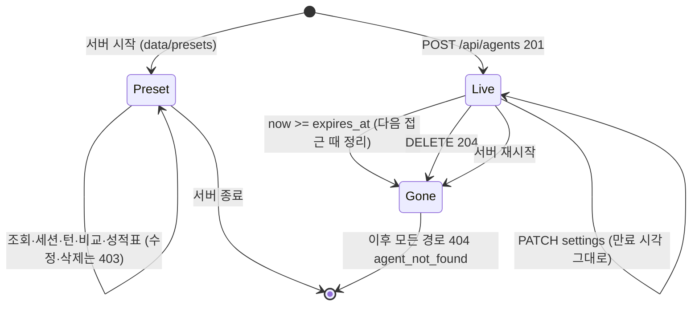

### 4.2 세션

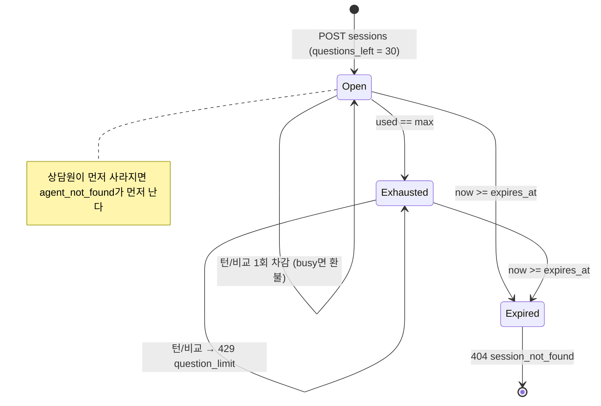

### 4.3 성적표 작업

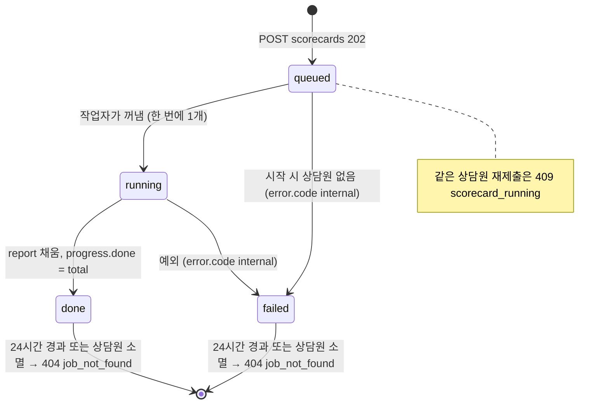

### 4.4 턴 (클라이언트가 관리할 상태)

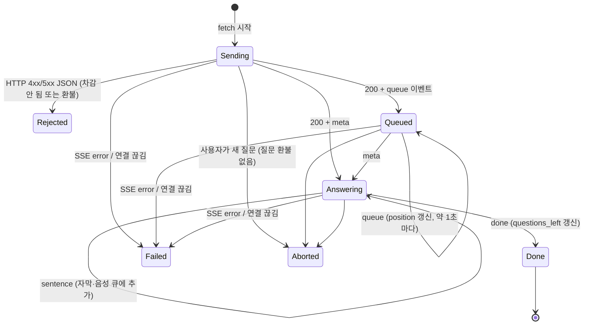

재생 상태(음성 큐)는 턴 상태와 따로 간다. `done`이 와도 재생은 계속될 수 있다.

---

## 5. 상한·설정값

### 5.1 환경변수 (`app/config.py`, pydantic-settings — 이름은 필드명 대문자, `.env` 파일도 읽음)

| 환경변수 | 기본값 | 의미 | 초과·잘못된 값일 때 |
|---|---|---|---|
| `AGENT_TTL_HOURS` | 24.0 | 사용자 상담원·세션 보존 시간 | 지나면 404 |
| `MAX_AGENTS` | 200 | 동시에 살아 있는 사용자 상담원 수 (프리셋 제외) | 503 `capacity_full` |
| `MAX_TEXT_CHARS` | 20000 | 텍스트 지식 글자 수 | 413 `knowledge_too_large` |
| `MAX_CSV_ROWS` | 300 | CSV 유효 행 수 (머리행·빈 행 제외, 중복 포함) | 413 |
| `MAX_CSV_CHARS` | 100000 | CSV 전체 글자 수 | 413 |
| `SESSION_MAX_QUESTIONS` | 30 | 세션당 질문 (턴·비교 1회 = 1) | 429 `question_limit` |
| `TURN_CONCURRENCY` | 2 | 동시에 답을 만드는 슬롯 | 나머지는 대기 |
| `TURN_QUEUE_MAX` | 8 | 슬롯 대기열 길이 (성적표 질문은 상한 무시) | 503 `busy` |
| `SCORECARD_QUEUE_MAX` | 4 | 실행 1개 외 대기 가능한 성적표 작업 | 503 `busy` |
| `PRESETS_DIR` | `data/presets` | 프리셋 폴더 | 형식 오류면 서버 시작 실패 |
| `STT_BACKEND` | `stub` | `stub`(음성 무시) \| `whisper` | 그 밖이면 시작 실패 |
| `STT_MODEL` | `small` | faster-whisper 모델 | |
| `STT_BEAM_SIZE` | 1 | | |
| `TTS_BACKEND` | `stub` | `stub`(무음) \| `supertonic` | 그 밖이면 시작 실패 |
| `TTS_VOICE` | `F1` | 기본 TTS 스타일. 레거시 API 음성, 그리고 상담원 목소리·F1 스타일을 둘 다 못 읽을 때의 최종 대체 | |
| `LLM_BACKEND` | `stub` | `stub` \| `qwen` | 그 밖이면 시작 실패 |
| `LLM_API_KEY` | `""` | 비면 요약 불가 (`summary_available: false`) | |
| `LLM_BASE_URL` | DashScope 국제 호환 엔드포인트 (`config.py:19`) | OpenAI 호환 `/chat/completions` | |
| `LLM_MODEL` | `qwen3.7-flash` | | |
| `LLM_TIMEOUT_S` | 8.0 | LLM 요청 시간 제한 | 넘으면 원문 대체 (D3) |
| `PIPELINE_MODE` | `stub` | `stub`만 허용 | 그 밖이면 시작 실패 |
| `RETRIEVER_BACKEND` | `keyword` | 레거시 API 전용 `keyword` \| `bm25` | |
| `FAQ_PATH` | `data/faq/sample_faq.json` | 레거시 API 전용 FAQ | |
| `PORT` | 8765 | 설정 필드는 있으나 앱 코드에서 읽지 않는다. 포트는 uvicorn `--port`가 정한다 | |

### 5.2 코드에 고정된 상한·상수

| 항목 | 값 | 위치 | `limits` 키 |
|---|---|---|---|
| 질문 글자 수 (`text`, `question`) | 1..500 | `agent_schemas.py:18` | `max_question_chars` |
| 상담원 이름 | 1..30, 기본 `"내 상담원"` | `agent_schemas.py:19-20` | 없음 |
| `persona_name` | 1..20 | `models.py:17` | `max_persona_name_chars` |
| `handoff_message` | 1..100 | `models.py:18` | `max_handoff_message_chars` |
| `avoid_topics` | 10개, 각 1..20 | `models.py:19-20` | `max_avoid_topics`, `max_avoid_topic_chars` |
| 녹음 크기 | 10 MiB | `audio.py:8` | 없음 |
| 최소 음성 | 1600샘플(16 kHz에서 0.1초), RMS 0.001 | `audio.py:9-10` | 없음 |
| 조각 크기 (텍스트) | 목표 400, 최대 600자, 제목 40자 | `knowledge.py:14-16` | 없음 |
| 검색 후보 | 3개 | `retrieval.py:34` | 없음 |
| 모름 기준 coverage | 0.20 | `retrieval.py:12` | 없음 |
| 근거 기준 overlap | 0.5 | `grounding.py:12` | 없음 |
| 답 문장 수 | 1 / 2 / 4 | `compose.py:14` | 없음 |
| 재생 단위 문장 | 10..150자 | `sentences.py:7-8` | 없음 |
| 대기 `queue` 간격 | 1초 | `agents.py:76` | 없음 |
| 비교 측별 대기 상한 | 60초 | `compare.py:15` | 없음 |
| 비교 첫 음성 차이 표시 기준 | 200 ms | `compare.py:16` | 없음 |
| 조각 목록 `limit` | 기본 50, 1..200 | `agents.py:266` | 없음 |
| 성적표 `n` | 10..30, 기본 30 | `agent_schemas.py:311` | 없음 |
| 성적표 작업 보존 | 86400초 | `jobs.py:61` | 없음 |
| 성적표 힌트 | 최대 3개, 긴 조각 600자, 말투 격차 20점 | `scorecard.py:22-24` | 없음 |
| LLM 출력 | `max_tokens` 160, `temperature` 0.2, 최대 3문장 | `llm_qwen.py:19,69-71` | 없음 |

---

## 6. 개인정보·보안 동작

| 데이터 | 어디로 가나 | 남는 곳 |
|---|---|---|
| 녹음 음성 | 이 서버 프로세스 안 STT만. **외부로 나가지 않는다** (요청 처리 중 외부 호출은 LLM 하나뿐, `llm_qwen.py`. 실제 STT·TTS 모델 파일은 서버 시작 때 내려받을 수 있으나 사용자 데이터는 담기지 않는다, `tts_supertonic.py:44`) | 메모리에서 처리 후 버림. 저장 안 함 |
| 질문 문장(글자·전사) | 요약 켜짐 + 서버 LLM 있음일 때만 외부 LLM API로 | 저장 안 함. 로그에 쓰지 않음 (`turn.py:1` 주석) |
| 지식(텍스트·CSV) | 상담원 메모리. 요약 켜짐이면 **검색 1위 조각 본문 1개**가 질문과 함께 외부 LLM으로 | 메모리, TTL 또는 재시작까지. 디스크·DB 없음 (`store.py:1`) |
| 설정의 호칭·모를 때 문구·피할 주제 | 요약 켜짐이면 시스템 프롬프트로 외부 LLM에 | 메모리 |
| 성적표 | 상담원 설정이 요약 켜짐이면 질문마다 외부 LLM 호출 (최대 60회) | 작업 결과 메모리 24시간 |
| 답 음성 | 서버 안 TTS가 만들어 응답으로만 보냄 | 저장 안 함 |

- **로그에 남는 것**: uvicorn 접근 로그(메서드·경로·쿼리 — 즉 `agent_id`, 음성 경로의 `session_id`, 상태 코드). 오류 시 traceback(`agents.py:356`, `stream.py:82`, `jobs.py:159`), LLM 실패 시 예외 **종류 이름만**(`llm_qwen.py:142`).
- **로그에 남지 않는 것**: 질문 본문, 전사, 문서 본문, 답 문장(앱이 직접 쓰는 로그 기준). traceback 안의 예외 메시지에 내용이 섞일 가능성은 미확인.
- **접근 제어 없음**: id를 아는 사람은 조회·대화·(사용자 상담원이면) 수정·삭제·성적표를 할 수 있다. id는 `secrets.token_hex(6)`(48비트) 난수.
- **남용 방지**: 세션 질문 수 상한, 대기열, 상담원 수 상한뿐. IP별 제한·캡차 없음. 세션은 누구나 새로 열 수 있다.
- **화면 책임**: 요약 스위치 옆에 "켜면 질문과 자료 일부가 외부 AI 서비스로 갑니다" 같은 안내를 두는 것은 클라이언트 몫이다.

---

## 7. 사용자 시나리오 → API 호출 순서

### 7.1 프리셋 체험

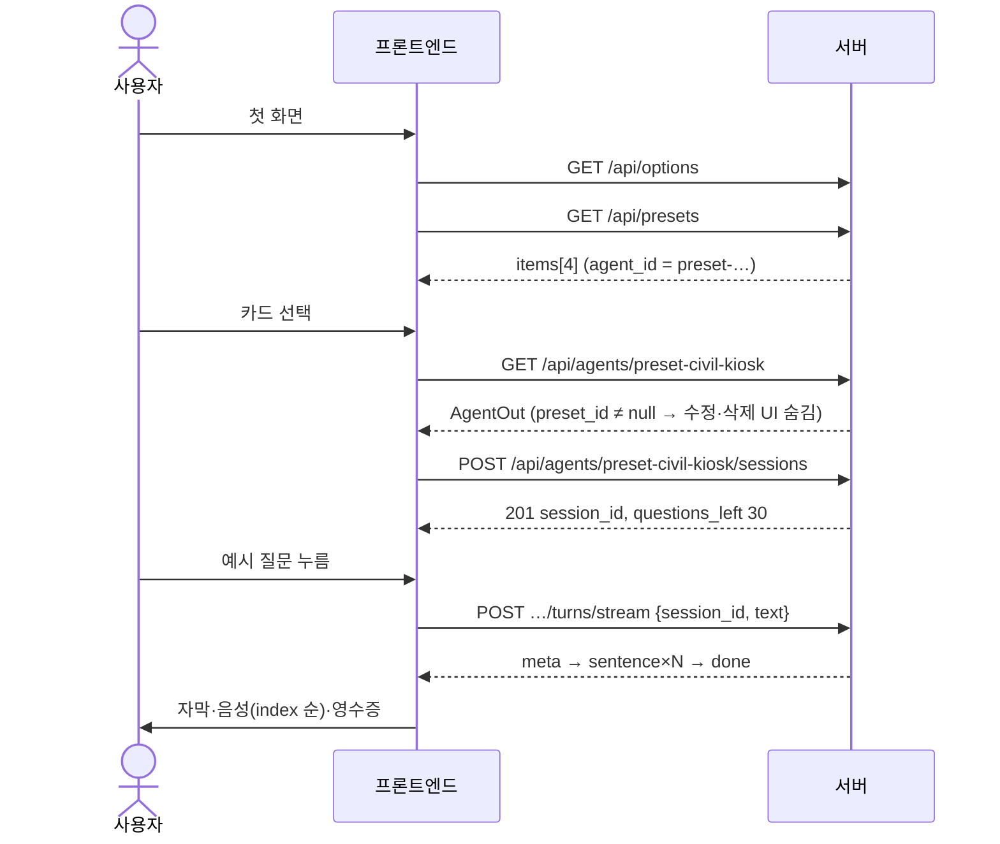

### 7.2 내 상담원 만들기

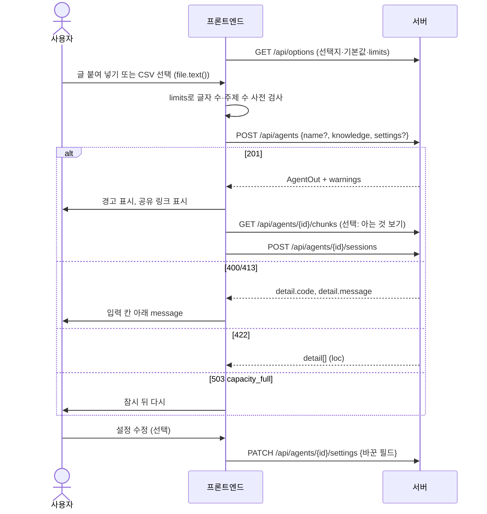

### 7.3 음성 질문

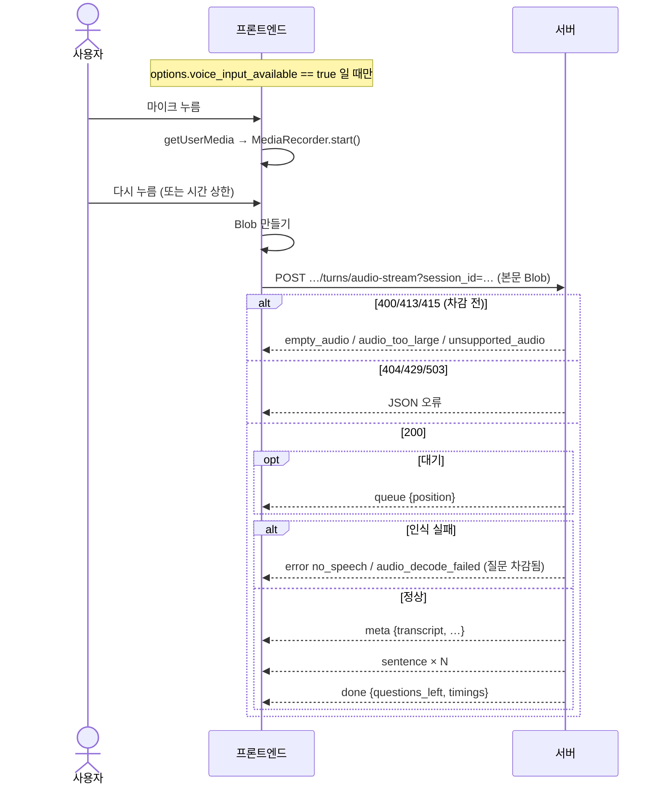

### 7.4 성적표

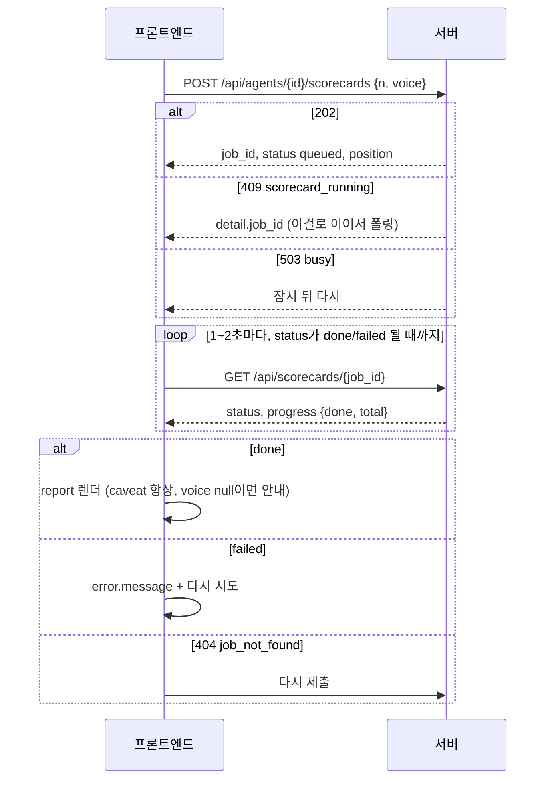

### 7.5 A/B 비교

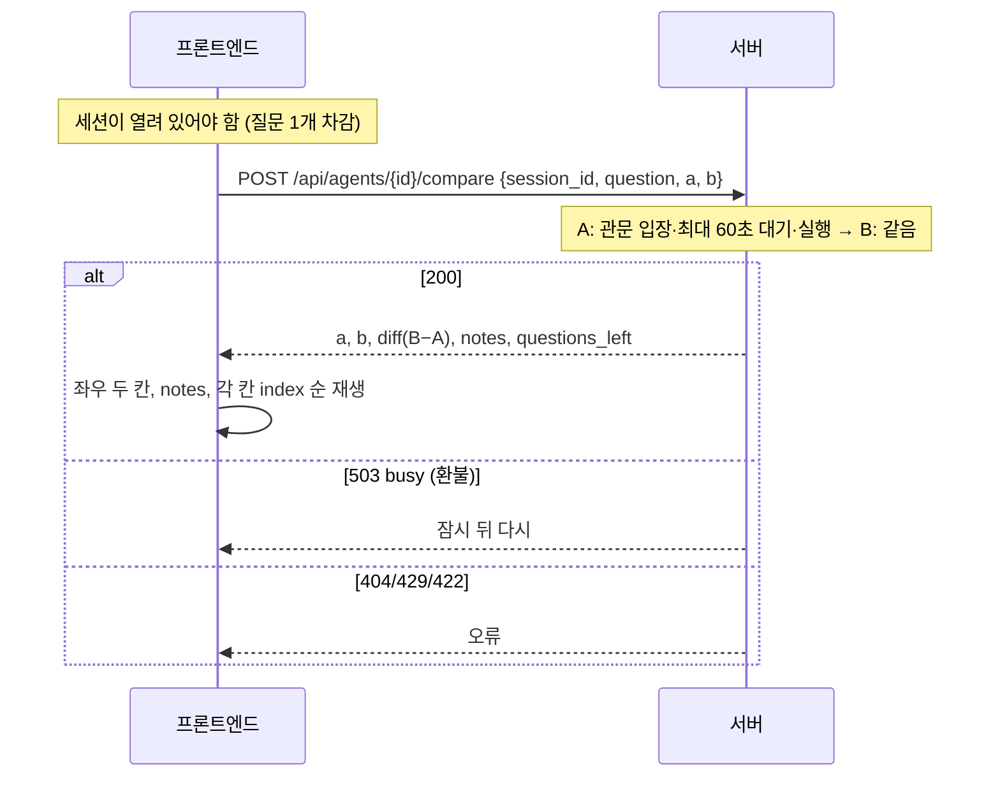

### 7.6 공유 링크로 들어옴

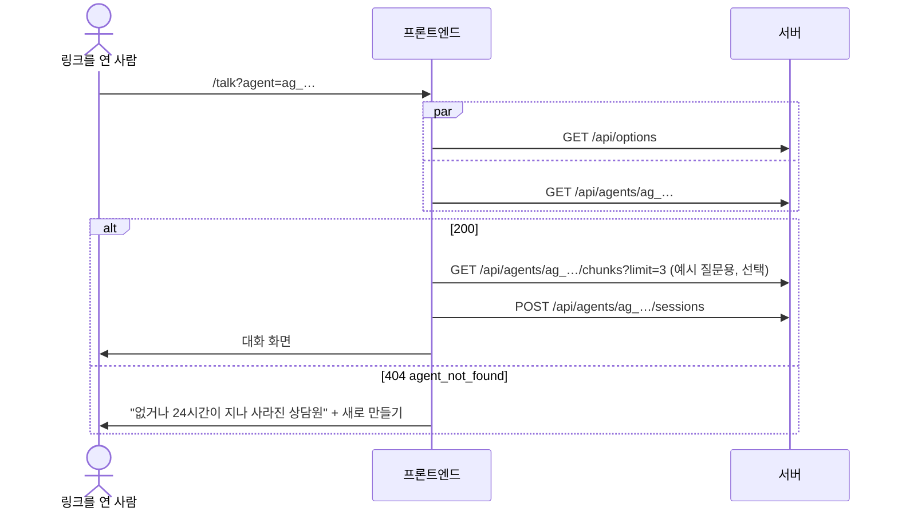

### 7.7 만료·오류 중간 발생

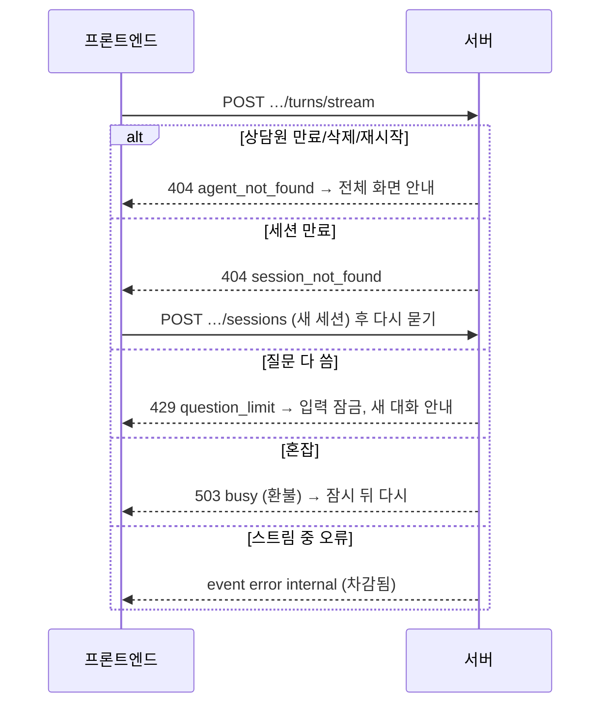

---

## 8. 프론트엔드 설계 시 결정할 것·주의점

### 8.1 서버가 보장하는 것 / 클라이언트 책임

| 서버가 보장 | 클라이언트 책임 |
|---|---|
| 이벤트 순서 `queue* → meta → sentence(index 순) → done`, 또는 `error`로 끝 | `done`/`error` 없는 종료 감지, 재시도 UX |
| 문장마다 완전한 WAV | 순서 재생, 자동재생 정책, 이전 재생 중단, 메모리 해제 |
| 모든 투명성 필드를 항상 보냄 | 영수증을 보일지·접을지, 지연 단위 표기 |
| 검증·상한 강제 (422/413/429/503) | `limits`로 사전 검사, 오류 code → 화면 문구 매핑 |
| `busy` 시 질문 환불 | 스트림 오류·중단 뒤 남은 질문 수 표시 |
| 프리셋 수정·삭제 거부 | 프리셋에서 해당 UI 숨김 |
| 만료 시 404 | 만료 화면, 새로 만들기 동선 |
| 같은 상담원 성적표 1개만 | 409를 이어받기로 처리, 폴링 주기·정지 |

### 8.2 결정해야 할 것

1. **출처(origin)**: CORS가 없다. 같은 서버의 `/static` 아래에 빌드 결과를 두거나, 개발 서버 프록시로 `/api`를 넘긴다. 다른 출처가 꼭 필요하면 백엔드 변경이 필요하다.
2. **라우팅과 공유 링크**: 서버의 `/studio`·`/studio/app`은 참고 구현 HTML을 돌려주고 `/`·`/talk`는 그리로 307 리다이렉트한다. 새 화면을 같은 경로에 두려면 서버 라우트(`app/main.py`)를 바꾸거나 다른 경로를 쓰고 `agent_id`로 링크를 만든다.
3. **세션 수명 관리**: 페이지마다 새 세션 / 탭 저장소에 보관 / 상담원별 하나. 404 `session_not_found` 자동 복구 여부.
4. **동시 질문 정책**: 이전 턴을 끊고 새로 묻기(참고 구현) vs 진행 중엔 입력 잠금. 끊으면 질문이 하나 더 줄어든다.
5. **경고 전달**: `warnings`는 201에서만 오니 만들기 → 대화 화면 전환 시 상태로 넘긴다.
6. **영수증 밀도**: 타이밍·근거·후보를 어디까지 기본으로 보여 줄지. 스텁 서버의 0 ms 값 처리(막대 숨김 등).
7. **오디오 재생 방식**: `<audio>` 하나 + 큐 vs Web Audio API(문장 간 간격 줄이기, 샘플레이트 무관하게 `decodeAudioData`).
8. **긴 요청의 타임아웃**: 비교(최대 약 120초+), 실제 모델 첫 턴, 성적표 폴링 간격.
9. **요약 스위치 노출**: `summary_available` + 개인정보 안내 문구.
10. **설정 수정·삭제·조각 목록 화면**: API는 있지만 참고 구현엔 없다. 넣을지 정한다.

### 8.3 알려진 한계

- **메모리 저장**: 재시작하면 사용자 상담원·세션·성적표·공유 링크가 사라진다. 여러 워커로 띄우면 상태가 갈라진다.
- **성적표 낙관성**: 질문이 문서 표현을 그대로 많이 담고(규칙 생성), 음성도 합성 음성이라 실제보다 점수가 높게 나온다. `caveat`을 늘 보여 준다. 구어체 검색 정확도는 top1 0.289(ADR-008·009).
- **bigram 근거의 한계**: 의미가 같은 바꿔 쓰기는 "근거 없음", 글자만 같고 틀린 문장은 "근거 있음"이 될 수 있다. 요약 켜짐에서 "근거 없음"이 늘 수 있다.
- **모름 기준**: civil-kiosk와 구어체 46행 한 세트로만 정한 0.20. 짧은 합성 FAQ 프리셋에서는 따로 재지 않았다.
- **Qwen 구성 E2E**: HANDOFF 기록상 `LLM_BACKEND=qwen`으로 띄운 서버에서는 E2E `test_stream_fallback_audio_per_sentence`가 실패해, 전체 모드 E2E는 `LLM_BACKEND=stub`으로 돈다. Qwen 구성 E2E 기준선은 남은 과제다(원인 미확인, `.ai/HANDOFF.md`). 레거시 경로도 `LLM_BACKEND=qwen`이면 Qwen을 쓴다는 점이 관련이 있을 수 있다(미확인).
- **`summary_used` 해석**: LLM 실패 시에도 `true`일 수 있다 (9절 1). "요약했다"는 표시로 단정하지 않는다.
- **스텁 서버**: 음성 입력이 항상 `no_speech`(질문 차감), 음성은 100 ms 무음, 시간 값 거의 0, 성적표 음성 채널 없음. 화면 개발은 스텁으로, 음성·지연 확인은 실제 모델 서버로.
- **비교·성적표는 같은 슬롯을 쓴다**: 성적표 실행 중에는 대화가 느려지거나 `busy`가 나기 쉽다.
- **취소 API 없음**: 성적표·비교를 중간에 멈출 수 없다(턴은 연결을 끊으면 슬롯만 반납).
- **녹음 시간 상한 없음**: 서버는 10 MiB만 본다. 긴 녹음은 STT 시간이 길어진다.
- **CSV 검색은 질문 칸만**: 답변에만 있는 낱말로 물으면 못 찾을 수 있다.

---

## 9. 문서 불일치·미확인 목록

### 9.1 문서 불일치 (코드를 따름)

| # | 문서 | 문서 내용 | 코드 실제 | 근거 |
|---|---|---|---|---|
| 1 | `docs/api.md` 부록 "생각" | LLM이 빈 답을 내거나 **실패하면** 조각 원문으로 답하고 `summary_used: false` | 네트워크·타임아웃·파싱 실패나 짧은 출력이면 Qwen 클래스가 1위 조각 원문 문장을 내므로 `summary_used: true`. `false`는 LLM이 문장을 하나도 안 낼 때만 | `llm_qwen.py:141-151`, `turn.py:101-102,143` |
| 2 | `docs/api.md` 3절 | 요약 시 질문과 "근거 조각 몇 개"가 외부로 | 검색 1위 조각 본문 **1개**만. 대신 시스템 프롬프트에 호칭·모를 때 문구·피할 주제가 함께 간다 | `llm_qwen.py:62-67`, `compose.py:47-58` |
| 3 | `docs/api.md` 5.11·2.3 | 비교가 "60초 넘게 기다림"이면 `busy` | A·B가 **각각** 따로 최대 60초 기다린다 (최악 약 120초 + 실행) | `compare.py:36-40,93-94` |
| 4 | `docs/api.md` 3절·5.13 | 성적표 결과는 "24시간" (상담원 TTL 설명과 나란히) | 작업 보존은 `AGENT_TTL_HOURS`와 무관한 고정 86400초 | `jobs.py:61`, `main.py:26` |
| 5 | `openspec/specs/agent-builder` "Queue and backpressure" | 턴과 성적표 질문이 같은 관문을 쓰고 대기는 최대 `TURN_QUEUE_MAX` | 성적표 질문은 `allow_overflow=True`로 대기 상한을 무시한다 (자리는 차지) | `scorecard.py:182`, `limits.py:112-119` |
| 6 | `docs/api.md` 2.2 | 422는 `loc` 마지막 값으로 필드를 안다 | 설정 값 검증 오류는 `loc`가 `["body"]`/`["body","settings"]`라 필드 이름이 `msg`에만 있다 | `agent_schemas.py:54-57`, 실측 |
| 7 | `docs/decisions.md` ADR-009 | 성적표 질문 "시드는 조각 id 정렬의 sha256" | sha256·시드가 없다. 정렬 + 균등 선택 + 위치 기반 규칙 순환으로 결정적. 음성 잡음 시드는 질문 순번 | `questions.py:77-104`, `scorecard.py:77` |
| 8 | `docs/decisions.md` ADR-009 | STT·TTS·LLM 인스턴스는 1차 Pipeline 것을 공유 / `AgentStore`가 상담원·세션을 둔다 | STT·TTS만 공유하고 LLM은 턴마다 시스템 프롬프트를 넣어 새로 만든다. 세션은 `SessionBook`이 둔다 | `main.py:25`, `runtime.py:98-125`, `limits.py:31` |
| 9 | `docs/api.md` 5.9·6절 | `queue`가 "1초 간격 안쪽으로" | 1초 기다림이 끝날 때마다 보낸다 (대략 1초 간격, 엄밀히 "안쪽"은 아님) | `agents.py:76,305-308` |
| 10 | `docs/api.md` 4절 `MAX_CSV_ROWS` | "유효 행 수 (머리행 제외)" | 빈 행을 뺀 뒤, 중복 질문을 빼기 **전** 수 | `knowledge.py:162` |
| 11 | `docs/api.md` 전체 | 빌더 API만 다룸 | 레거시 `/health`, `/api/ask`, `/api/ask-audio`, `/api/ask-stream`, `/api/ask-audio-stream`도 살아 있다 (L절) | `routes.py`, `stream.py` |
| 12 | 프로젝트 `CLAUDE.md` 스택 | "LLM은 스텁" | `LLM_BACKEND=qwen` + 키면 Qwen 요약이 동작한다 (기본은 스텁) | `runner.py:67-80`, `runtime.py:124-125` |

### 9.2 미확인

- 스트림 중 클라이언트가 끊었을 때, 진행 중이던 STT/TTS 호출이 언제 멈추는지 (슬롯 반납은 `BackgroundTask`로 확인, 작업 스레드 중단 시점은 미확인).
- 처리되지 않은 예외(예: 비교 중 내부 오류)의 500 응답 본문 형식 (FastAPI/Starlette 기본으로 추정, 실측 안 함).
- Supertonic 실제 출력 샘플레이트 (모델 테스트가 44,100 Hz를 기대하지만 이번에 실제 모델로 재지 않음).
- 오류 traceback 로그에 질문·문서 내용이 섞일 가능성.
- 요청 본문 크기에 대한 서버(uvicorn) 단 제한 유무.
- Qwen 구성 E2E 실패(`test_stream_fallback_audio_per_sentence`)의 원인.
- 409 `scorecard_running`: 스텁에서는 작업이 1초 안에 끝나 재현하지 못했다 (코드 `jobs.py:81-84`로만 확인).
- 503 `busy`·`queue` 이벤트: 동시 요청이 필요해 실측하지 않았다 (코드로만 확인, ADR-010도 E2E 없음).

---

## 부록: 엔드포인트 전체 색인

`create_app()`의 라우트(HEAD 제외) 24개 + 정적 마운트 1개.

| 메서드 | 경로 | 기능 ID | SSE | 비고 |
|---|---|---|---|---|
| GET | `/api/options` | K1 | 아니오 | |
| GET | `/api/presets` | A1 | 아니오 | |
| POST | `/api/agents` | B1 (B2·B3) | 아니오 | 201 |
| GET | `/api/agents/{agent_id}` | A2, I1 | 아니오 | |
| PATCH | `/api/agents/{agent_id}/settings` | B5 | 아니오 | |
| DELETE | `/api/agents/{agent_id}` | I3 | 아니오 | 204 |
| GET | `/api/agents/{agent_id}/chunks` | B4 | 아니오 | |
| POST | `/api/agents/{agent_id}/sessions` | C1 | 아니오 | 201 |
| POST | `/api/agents/{agent_id}/turns/stream` | D1, D3, D4, E1~E4, F1 | 예 | 질문 차감 |
| POST | `/api/agents/{agent_id}/turns/audio-stream` | D2, D3, D4, E1~E4, F1 | 예 | 쿼리 `session_id`, 원시 바이트 |
| POST | `/api/agents/{agent_id}/compare` | H1 | 아니오 | 질문 차감 |
| POST | `/api/agents/{agent_id}/scorecards` | G1 | 아니오 | 202 |
| GET | `/api/scorecards/{job_id}` | G2 | 아니오 | |
| GET | `/health` | L1 | 아니오 | 레거시 |
| POST | `/api/ask` | L2 | 아니오 | 레거시 |
| POST | `/api/ask-audio` | L2 | 아니오 | 레거시, 원시 바이트 |
| POST | `/api/ask-stream` | L3 | 예 | 레거시 |
| POST | `/api/ask-audio-stream` | L3 | 예 | 레거시, 원시 바이트 |
| GET | `/` | L4 | 아니오 | 307 → `/studio` |
| GET | `/talk` | L4 | 아니오 | 307 → `/studio/app` |
| GET | `/studio` | L4 | 아니오 | 참고 구현 HTML |
| GET | `/studio/app` | L4 | 아니오 | 참고 구현 HTML |
| GET | `/openapi.json` | L4 | 아니오 | FastAPI 기본 |
| GET | `/docs` | L4 | 아니오 | FastAPI 기본 |
| GET | `/docs/oauth2-redirect` | L4 | 아니오 | FastAPI 기본 |
| GET | `/redoc` | L4 | 아니오 | FastAPI 기본 |
| (mount) | `/static/*` | L4 | 아니오 | `app/static/` |
