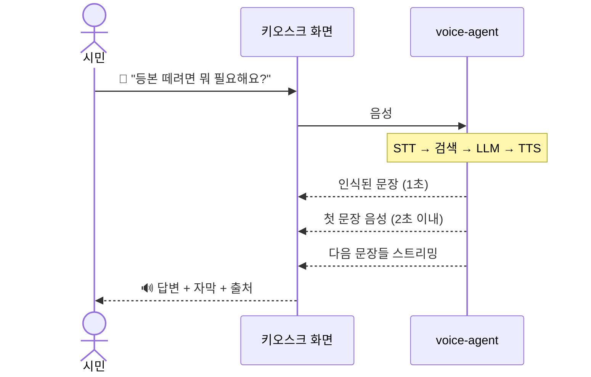

# voice-agent — 완성된 모습

> 이 문서는 "어떻게 만들까"가 아니라 "다 만들어졌을 때 사용자가 무엇을 보고 겪는가"를 적는다.
> 내부 구조는 나중에 docs/system-overview.md 와 docs/decisions.md 에서 다룬다.
> 원본은 회사에서 public kiosk client를 위해 만든 시스템이고, 여기서는 공개 민원 FAQ 데이터로 처음부터 다시 만든다.

## 한 문장

무인 민원 발급기 앞에서 "등본 떼려면 뭐 필요해요?"라고 말하면 2초 안에 목소리로 답이 시작되고, 어느 단계에서 몇 초가 걸렸는지가 그래프로 남는다.

## 등장인물

| 역할 | 상황 | 바라는 것 |
|---|---|---|
| 키오스크 앞 시민 (60대) | 화면 글씨가 작고 메뉴가 많다, 뒤에 사람이 기다린다 | 말로 묻고 말로 듣고 싶다, 10초 넘게 기다리긴 싫다 |
| 포트폴리오를 읽는 엔지니어·채용 담당자 | 레포를 5분 본다 | "병목을 어떻게 찾고 얼마나 줄였나"를 표 하나와 그림 하나로 보고 싶다 |
| 재현하는 사람 | 레포를 클론해 명령 몇 개 돌린다 | 같은 숫자가 나와야 믿는다 |

## 시나리오 1: 시민, 말로 묻고 말로 듣기

1. 화면의 마이크 버튼을 누르고 말한다: "주민등록등본 떼려면 뭐 가져와야 돼요?"
2. 말이 끝나고 1초쯤 뒤 화면에 들은 문장이 글자로 뜬다. "주민등록등본 발급에 필요한 것을 찾고 있어요..."
3. 2초 안에 목소리가 시작된다: "주민등록등본은 본인 신분증만 있으면 발급됩니다. 수수료는..." 문장 단위로 끊김 없이 이어진다.
4. 화면에는 같은 내용이 글자로, 아래에 "출처: 정부 민원 안내 FAQ" 한 줄.
5. 다 듣고 "수수료는요?"라고 이어 물으면 앞 맥락을 알고 답한다.

## 시나리오 2: 읽는 사람, 5분 안에 핵심

1. README 상단에 그림 하나: 한 질문의 응답 시간을 단계별로 쌓은 막대 두 개(before / after).
2. 그 아래 표: 전체 응답 시간, 단계별(STT·검색·LLM·TTS) 지연, 동시 요청 시 분포.
3. "무엇을 바꿨나" 네 줄: 문장 단위 스트리밍 TTS, GPU 요청 직렬화, TTS 재시도 방식, 검색 Top-K.
4. "원본 환경" 줄은 별도 표시로 분리돼 있어 공개 데이터 결과와 섞이지 않는다.

## 시나리오 3: 재현하는 사람

```
$ git clone <repo> && cd voice-agent
$ cp .env.example .env
$ docker compose up -d
$ ./scripts/prepare_data.sh          # 공개 FAQ 내려받고 인덱스 생성
$ ./bench/run.sh --config before     # 질문 50개 × 3회
$ ./bench/run.sh --config after
$ ./bench/summarize.sh               # 표 출력, README에 붙여 넣는 형식
```

## 화면·결과물 스케치

키오스크 데모 화면(웹):

```
┌─────────────────────────────────────────┐
│  🎤 말씀하세요                            │
│                                         │
│  👤 "주민등록등본 떼려면 뭐 가져와야 돼요?" │
│                                         │
│  🔊 주민등록등본은 본인 신분증만 있으면     │
│     발급됩니다. 수수료는 1통에 400원이고,   │
│     무인발급기에서는 ...                   │
│     ▌(재생 중)                             │
│  출처: 민원 안내 FAQ #1203                 │
│                                         │
│  ⏱ 듣기 0.6s · 검색 0.2s · 생각 0.4s · 말하기 시작 0.7s│
└─────────────────────────────────────────┘
```

README의 핵심 그림(단계별 지연 폭포):

```
 질문 1건 응답 시간 (중앙값, 공개 FAQ 50문항)

 before  ├STT 0.9┤├검색 0.4┤├LLM 1.2┤├────────── TTS 4.1 ──────────┤  = 6.6s
 after   ├STT 0.9┤├검색 0.2┤├LLM 0.5┤├─ TTS 첫 문장 0.7 ─┤ (나머지 스트리밍)  = 첫 음성까지 2.3s
         0        1        2        3        4        5        6        7 (s)
```

동시 요청 분포:

```
 동시 4요청 시 첫 음성까지 시간
 before  p50 ████████████ 6.8s   p95 ████████████████████ 11.2s
 after   p50 ████ 2.5s          p95 ███████ 3.9s
```

## 흐름도




## MVP가 끝났을 때 손에 쥐는 것

- 돌아가는 음성 파이프라인(웹 데모 1페이지): 말하기 → 자막 → 음성 답변 + 출처.
- before / after 두 구성과 같은 질문 세트 50개.
- bench 결과표와 폭포 그림.

| 지표 | before | after | 비고 |
|---|---|---|---|
| 첫 음성까지 시간 (p50 / p95) | | | 공개 FAQ, 같은 기계 |
| 전체 응답 시간 | | | |
| 단계별: STT / 검색 / LLM / TTS | | | |
| TTS RTF (동시 1 / 4 요청) | | | |
| 원본 환경 (참고, 비교 불가) | 10.52s | 7.40s | 별도 줄로만 |

- 30초 데모 영상.

## "됐다"고 말할 수 있는 순간

- 처음 보는 사람이 마이크 버튼만 보고 질문해서 음성 답을 듣는다.
- README 표의 모든 숫자가 `bench/` 명령으로 다시 나온다.
- 어떤 최적화가 어느 단계를 줄였는지 그림 한 장으로 설명된다.

## 이번엔 안 만드는 것

키오스크 화면 전환 태그 연동, 실제 민원 발급, 다국어. (doc/portfolio/overview.md 참조)
